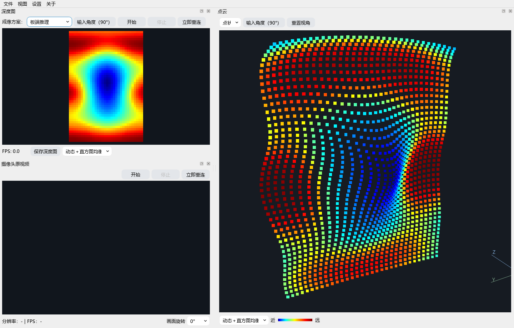
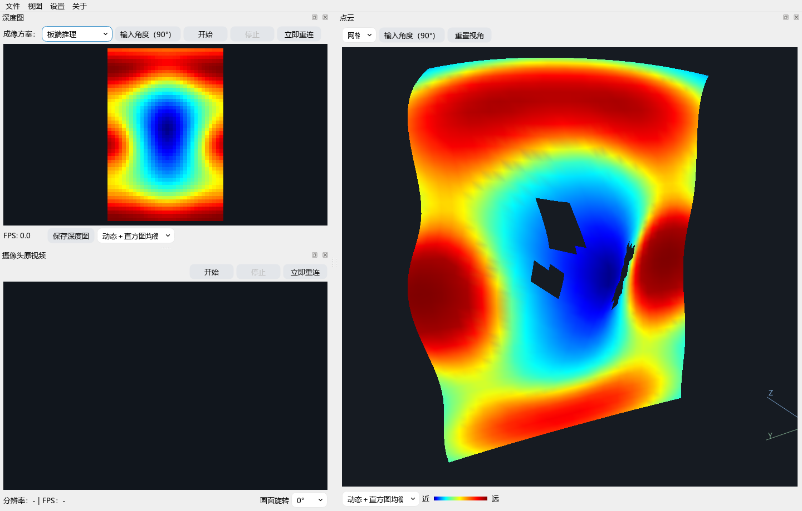

# CXWL Depth Camera SDK API 参考

SDK v3.0.0 (3.0.0) / ABI v3 · Windows x64 C/C++ · Windows USB 直连 · 1.0.0-preview.2-usb-direct。46 个公开函数。

相关的数值、配置和函数指针见 [枚举值](#枚举值)、[宏定义](#宏定义)和[回调类型](#回调类型)。

## 选择连接方式

每个进程最多使用一个采集会话。每次接入选择一个入口即可。

| 入口 | 适合的场景 | 调用顺序 |
|---|---|---|
| `CxwlDepth_Connect` | 首次接入、运行 QuickStart 或快速确认深度和视频可用。SDK 按默认策略选择设备，按需完成 USB 登记并启动采集。 | `CxwlDepth_Connect` → 接收帧 → `CxwlDepth_Disconnect` |
| `CxwlDepth_ConnectWithOptions` | 应用已选中一台相机、要连接刚检查过的 USB 设备，或现场只允许连接已登记设备。应用明确指定目标和准备策略，SDK 负责连接并启动。 | 填写 `CxwlDepthConnectOptions` → `CxwlDepth_ConnectWithOptions` → 接收帧 → `CxwlDepth_Disconnect` |
| `CxwlDepth_Open` | 应用需要在采集前配置会话，并自行控制启动时机。例如产线检测软件先选相机和档位，等操作员点击「开始检测」再启动。 | `CxwlDepth_Open` → `CxwlDepth_Subscribe` 或 `CxwlDepth_SubscribeEx` → 按需选择设备及档位 → `CxwlDepth_Start` → 接收帧 → `CxwlDepth_Close` |

`CxwlDepth_Open` 通过 `CxwlDepthOptions` 接受运行目录和设备档案的绝对路径。创建后会话处于停止状态，可通过 `CxwlDepth_ListDevicesAlloc` 取得已登记设备的 ID，再用 `CxwlDepth_SelectDevice` 选设备，用 `CxwlDepth_SetMode` 选模式。首次 USB 登记可在会话空闲时调用 `CxwlDepth_CheckUsb`，派发事件并通过 `CxwlDepth_GetUsbStatusAlloc` 取得有效的 `check_id`，随后调用 `CxwlDepth_EnrollUsb`，将 `start_after` 设为 0。登记完成后即可配置并调用 `CxwlDepth_Start`。

`CxwlDepth_Connect`、`CxwlDepth_ConnectWithOptions` 和 `CxwlDepth_Start` 返回 `CXWL_DEPTH_OK` 表示启动请求已受理。调用 `CxwlDepth_GetSessionStatus` 查询进度，状态达到 `CXWL_DEPTH_STATE_STREAMING` 时，视频和深度均已就绪。连接时未传帧回调的应用应随即调用 `CxwlDepth_Subscribe` 或 `CxwlDepth_SubscribeEx`。SDK 只派发订阅后的帧。需要先完成订阅再启动时，可使用 `CxwlDepth_Open`。

所有句柄操作在创建线程调用。独立 C/C++ 程序使用 `CxwlDepth_WaitForEvent` 或 `CxwlDepth_Poll` 派发会话事件，Qt 程序使用主线程事件循环。需要在回调结束后使用帧数据时，在回调内逐行复制要保留的图像和质量图，复制需要的设备标识、采集代次和元数据字符串。

### 停止与释放

需要保留会话以便稍后继续采集时，调用 `CxwlDepth_Stop`。该调用会取消尚未执行的启动请求。等状态达到 `CXWL_DEPTH_STATE_STOPPED` 后，已准备就绪的设备可再次调用 `CxwlDepth_Start`。设备尚未准备时，`CxwlDepth_Start` 返回 `CXWL_DEPTH_DEVICE_NOT_FOUND`。

结束使用时，`CxwlDepth_Close` 和 `CxwlDepth_Disconnect` 都能停止采集并释放会话。对同一句柄选择一个释放入口。返回 `CXWL_DEPTH_BUSY` 时，保留句柄和回调上下文，继续派发事件并在创建会话的线程重试。返回 `CXWL_DEPTH_OK` 后立即清空所存句柄，同一旧句柄不得再次传入 SDK。

### 等待会话回调

`CxwlDepth_WaitForEvent(session, timeout_ms, &dispatched)` 使用当前所有者线程派发帧与事件。返回 OK 且 `dispatched == 1` 表示执行了至少一次会话回调。返回 OK 且 `dispatched == 0` 表示时限内无回调，应用仍可检查状态或决定退出。超时 0 仅处理就绪事件。正数限制空闲等待，已经开始的回调会在返回前执行完毕。调用前先注册所需回调，回调期间继续遵守只读查询规则。管理器使用 `CxwlDepth_PollDeviceManager`，Qt 应用使用自己的事件循环。

## 目标和策略

`CxwlDepth_ConnectWithOptions` 的选项仅作用于本次请求。指定一台已登记设备时，将 `target` 设为 `CXWL_DEPTH_TARGET_SAVED`，将 `device_id_utf8` 设为登记列表的 `id`。只使用已登记设备时选用 `CXWL_DEPTH_CONNECT_SAVED_ONLY`。需要在接入时核验预装服务并登记时选用 `CXWL_DEPTH_CONNECT_PREPARE`。连接刚检查过的 USB 相机时，将 `target` 设为 `CXWL_DEPTH_TARGET_USB` 并传入同一管理器签发的有效 `usb_check_id`。SDK 在登记前再次核对实物。

应用已打开设备管理器时，通过 `CxwlDepth_Connect` 或 `CxwlDepth_ConnectWithOptions` 创建采集会话。`CxwlDepth_ConnectWithOptions` 此时沿用管理器的路径，两个路径选项须为 `NULL`。`CxwlDepth_SetConnectionTarget` 为下一次 `CxwlDepth_Connect` 指定一次性目标。`Connect` 返回 OK 即消耗该目标，即使后续异步启动失败。同步拒绝时仍保留目标。显式 `ConnectWithOptions` 只使用传入的选项，保留管理器待用目标。`CxwlDepth_SelectDevice` 接受登记列表返回的 ID，并在会话停止且空闲时切换设备。

## 所有者线程与回调

每个进程最多一个管理器和一个采集会话。管理器内部会话可由 Connect 系列借用；这不会产生第二个采集会话。独立 C/C++ 程序无需创建 Qt 对象，可选择主线程或固定的工作线程拥有整个会话；已有 Qt 应用必须在其事件循环线程创建句柄。独立 C 程序可调用 `CxwlDepth_PollDeviceManager` 派发管理器事件。

帧／事件回调允许只读查询，例如 `CxwlDepth_GetSessionStatus`、`CxwlDepth_GetDeviceInfo`、`CxwlDepth_GetStateAlloc`，管理器回调可用 `CxwlDepth_GetManagerStatus`，禁止控制、重新订阅和关闭。这些操作返回 BUSY。把后续控制安排到回调返回以后。日志回调不同：在日志回调中只复制日志。重入受保护入口返回 `CXWL_DEPTH_BUSY`。`CxwlDepth_AbiVersion` 直接返回版本，`CxwlDepth_GetLastError` 直接复制线程错误记录。日志注册与注销必须和其他线程调用串行。有现存句柄时，可在所有者线程、帧／事件回调外更改日志回调。

## 状态与错误

GetSessionStatus 对各入口创建的会话返回同一结构，状态枚举为 STOPPED、CONNECTING、STREAMING、RECOVERING、STOPPING、ERROR。GetManagerStatus 提供 busy、can_manage、maintenance_running 和 usb_check_id。

GetLastError 查询本线程最近同步失败的函数、错误码和说明，成功调用不会擦除。GetStateAlloc／GetDeviceManagerStateAlloc 提供 USB、维护和底层详细诊断。异步失败通过事件与结构化状态报告，连接结果可用 GetSessionStatus 确认。

## 结构体初始化与输出缓冲区

对包含 `size` 字段的输入选项和输出结构体，先清零，再将 `size` 设置为 `sizeof(结构体类型)`。连接选项中的 `abi_version` 设置为 `CXWL_DEPTH_ABI_VERSION`；该值用于检查头文件与运行库的接口约定。

例如，查询会话状态时：

```c
CxwlDepthSessionStatus status = {0};
status.size = sizeof(status);
CxwlDepthResult result = CxwlDepth_GetSessionStatus(session, &status);
```

SDK 填写的帧按 `frame->size >= offsetof(CxwlDepthFrame, image) + sizeof(frame->image)` 这类条件检查成员是否存在。

使用 Alloc 版本一次取得 JSON 快照，再调用 FreeJson 释放。2.0.0 引入五个分配型查询，自 2.2.0 弃用对应的缓冲区接口。现有应用仍可调用这五个缓冲区接口。空缓冲区取得含 NUL 的容量后再分配读取；遇到 BUFFER_TOO_SMALL 时按返回容量重试。业务状态判断使用 GetSessionStatus／GetManagerStatus。

## 订阅与设备管理

Subscribe 提供图像帧，SubscribeEx 还提供深度帧对应的 SNR 和有效位。两者互相替换订阅，每次仅使用一种帧回调。设备管理操作要求先释放采集句柄；单独 Stop 后句柄仍存在，不能进行板端维护。

## C++17 拥有型辅助类

`cxwl::Session` / `cxwl::Manager` 在创建线程拥有句柄，`get()` 返回供 C API 借用的句柄。构造前准备好回调上下文，并使回调上下文活到句柄关闭成功。拥有者固定在创建线程，禁止复制和移动。独立程序在该线程析构时派发事件直到关闭完成。先关闭采集会话，再关闭借出该会话的管理器。Qt 应用关闭返回 BUSY 时保留拥有者对象，由事件循环继续派发并重试 `try_close()`。Qt 窗口收到关闭请求时调用 `try_close()`，返回 false 则暂缓销毁窗口，在下一轮定时器或事件循环重试，返回 true 后再销毁拥有者和回调上下文。析构必须在所有者线程、回调之外执行，遇到无法安全完成的关闭会终止进程。

`cxwl::Error::code` 是本次调用结果，`info` 保留线程最近的 `CxwlDepthErrorInfo`。两个错误码不同时，异常文本会标明前一次错误的来源。`cxwl::check(result, session)` 在可查询会话时额外保存 `session_status`，其中包含状态、错误类别和连接阶段。`DepthFrame` 和 `VideoFrame` 拥有回调帧的图像及字符串副本。`Image` 接受 data 为空且宽高均为 0 的空图像。`project()` 接受 8×8、16×16 或 48×32 米制径向深度图。

## ABI v3 迁移

Windows 3.0.0 开发版需要重新编译使用 ABI v2 的客户程序。CxwlDepthCapabilities 的模式数组扩为六项，结构为 72 字节。先比较 CxwlDepth_AbiVersion() 与头文件宏，再创建句柄。RGB 校正改用独立工具。需要点云时，在深度回调中使用 CxwlDepth_GetFramePointCloud，跨回调使用前复制 XYZ。查询板端标定版本使用 CxwlDepth_GetDeviceInfo。

## 结构体索引

| 结构体 | 用途 |
|---|---|
| [`CxwlDepthCapabilities`](#cxwldepthcapabilities) | ABI v3 的六档采集能力、图像格式、测量质量数据和会话能力。 |
| [`CxwlDepthConnectOptions`](#cxwldepthconnectoptions) | 指定一次自动连接的采集档位、设备目标和准备策略。 |
| [`CxwlDepthDeviceInfo`](#cxwldepthdeviceinfo) | 当前选中设备的档案信息和本会话观察到的标定版本。 |
| [`CxwlDepthErrorInfo`](#cxwldeptherrorinfo) | 当前线程最近一次同步 API 失败的结果和诊断信息。 |
| [`CxwlDepthFrame`](#cxwldepthframe) | 视频或深度回调提供的一帧图像及其采集信息。 |
| [`CxwlDepthFrameEx`](#cxwldepthframeex) | 扩展帧回调提供的基础帧和同帧测量质量图。 |
| [`CxwlDepthImage`](#cxwldepthimage) | 描述一幅图像的像素缓冲区、尺寸、行跨度和格式。 |
| [`CxwlDepthManagerStatus`](#cxwldepthmanagerstatus) | 设备管理器的可操作状态、维护状态及 USB 检查结果标识。 |
| [`CxwlDepthOptions`](#cxwldepthoptions) | 分步创建采集会话或指定设备管理器路径时使用的选项。 |
| [`CxwlDepthPoint`](#cxwldepthpoint) | 点云中一个三维点的坐标，也用来表示标称单位射线的三个分量。 |
| [`CxwlDepthSessionStatus`](#cxwldepthsessionstatus) | 采集会话的状态快照，包含连接进度、两条数据流状态及切档信息。 |
| [`CxwlDepthVersionInfo`](#cxwldepthversioninfo) | SDK 的语义版本、ABI 版本和编译时间。 |

## 接口索引

| 函数 | 作用 |
|---|---|
| [`CxwlDepth_ConnectWithOptions`](#cxwldepth_connectwithoptions) | 以本次请求的显式目标、策略和路径创建并启动会话。 |
| [`CxwlDepth_GetVersionInfo`](#cxwldepth_getversioninfo) | 查询 SDK 语义版本、ABI 版本和编译时间。 |
| [`CxwlDepth_GetLastError`](#cxwldepth_getlasterror) | 复制本线程最近一次同步 API 失败。 |
| [`CxwlDepth_SetLogCallback`](#cxwldepth_setlogcallback) | 设置进程级错误日志回调；空回调关闭日志。 |
| [`CxwlDepth_GetSessionStatus`](#cxwldepth_getsessionstatus) | 查询指定会话的结构化状态，各连接入口使用同一格式。 |
| [`CxwlDepth_GetManagerStatus`](#cxwldepth_getmanagerstatus) | 查询结构化管理器状态。 |
| [`CxwlDepth_GetDeviceInfo`](#cxwldepth_getdeviceinfo) | 查询已选设备档案和最近有效深度帧的标定版本。 |
| [`CxwlDepth_GetCapabilities`](#cxwldepth_getcapabilities) | 查询本 SDK 的 ABI v3 基线能力与格式，无须连接硬件。 |
| [`CxwlDepth_SubscribeEx`](#cxwldepth_subscribeex) | 设置扩展帧回调，提供同一测量帧的 SNR 和有效位。 |
| [`CxwlDepth_AbiVersion`](#cxwldepth_abiversion) | 查询运行库的 C ABI 版本。 |
| [`CxwlDepth_Connect`](#cxwldepth_connect) | 使用默认路径自动创建并启动采集会话。 |
| [`CxwlDepth_Disconnect`](#cxwldepth_disconnect) | 停止采集并在后台作业退出后释放会话。 |
| [`CxwlDepth_Open`](#cxwldepth_open) | 使用显式路径创建停止状态的会话。 |
| [`CxwlDepth_Close`](#cxwldepth_close) | 停止并释放会话，退出语义与 Disconnect 一致。 |
| [`CxwlDepth_Subscribe`](#cxwldepth_subscribe) | 设置图像帧及事件回调，替换 SubscribeEx。 |
| [`CxwlDepth_Poll`](#cxwldepth_poll) | 在独立 C 程序的所有者线程推进事件。 |
| [`CxwlDepth_WaitForEvent`](#cxwldepth_waitforevent) | 在独立 C/C++ 程序的所有者线程派发事件，等待会话回调或超时。 |
| [`CxwlDepth_ListDevices`](#cxwldepth_listdevices-buffer) | 列出登记设备，停止和采集会话均可查询。 |
| [`CxwlDepth_GetState`](#cxwldepth_getstate-buffer) | 获取 UTF-8 JSON 状态与详细诊断。 |
| [`CxwlDepth_SelectDevice`](#cxwldepth_selectdevice) | 在停止且空闲时选择登记设备。 |
| [`CxwlDepth_SetMode`](#cxwldepth_setmode) | 选择原生分辨率和精度档位，采集中切换会异步重启。 |
| [`CxwlDepth_Start`](#cxwldepth_start) | 启动已选择且准备就绪的设备，适用于 Open 和 Connect。 |
| [`CxwlDepth_Stop`](#cxwldepth_stop) | 停止采集但保留句柄、回调和配置，适用于所有会话。 |
| [`CxwlDepth_Reconnect`](#cxwldepth_reconnect) | 重新启动当前设备采集并保留会话。 |
| [`CxwlDepth_RecoverDevice`](#cxwldepth_recoverdevice) | 清理所选设备的故障状态，并恢复配套采集运行环境。 |
| [`CxwlDepth_CheckUsb`](#cxwldepth_checkusb) | 停止且空闲时只读检查 USB 接入，核对物理 USB 网卡、相机序号及设备实例标识。 |
| [`CxwlDepth_GetUsbStatus`](#cxwldepth_getusbstatus-buffer) | 读取 USB 检查／登记诊断 JSON。 |
| [`CxwlDepth_EnrollUsb`](#cxwldepth_enrollusb) | 基于有效检查 ID 登记设备，可选择随后启动采集。 |
| [`CxwlDepth_OpenDeviceManager`](#cxwldepth_opendevicemanager) | 打开可选设备管理器。 |
| [`CxwlDepth_CloseDeviceManager`](#cxwldepth_closedevicemanager) | 关闭空闲管理器，必须先释放采集会话。 |
| [`CxwlDepth_PollDeviceManager`](#cxwldepth_polldevicemanager) | 推进独立程序的管理器事件。 |
| [`CxwlDepth_ListSavedDevices`](#cxwldepth_listsaveddevices-buffer) | 列出保存的设备及不透明 ID，不代表当前在线。 |
| [`CxwlDepth_SetActiveDevice`](#cxwldepth_setactivedevice) | 在无采集会话时保存默认设备。 |
| [`CxwlDepth_RemoveSavedDevice`](#cxwldepth_removesaveddevice) | 删除本机登记记录，不卸载驱动或板端程序。 |
| [`CxwlDepth_ScanUsb`](#cxwldepth_scanusb) | 在管理器空闲时启动只读 USB 检查。 |
| [`CxwlDepth_GetDeviceManagerState`](#cxwldepth_getdevicemanagerstate-buffer) | 读取管理器 USB／维护详细状态 JSON。 |
| [`CxwlDepth_SetConnectionTarget`](#cxwldepth_setconnectiontarget) | 设置下一次 CxwlDepth_Connect 的目标。同步返回 OK 时消耗，同步失败时保留。显式 CxwlDepth_ConnectWithOptions 独立使用自身选项。 |
| [`CxwlDepth_MaintainBoardFiles`](#cxwldepth_maintainboardfiles) | 在采集句柄已释放后检查／修复或维护受管板端文件。 |
| [`CxwlDepth_GetFramePointCloud`](#cxwldepth_getframepointcloud) | 从当前深度回调取得 RV1103 计算的同帧 XYZ 点云。 |
| [`CxwlDepth_SavePointCloudPly`](#cxwldepth_savepointcloudply) | 将一帧板端 XYZ 点云保存为二进制 PLY。 |
| [`CxwlDepth_ListDevicesAlloc`](#cxwldepth_listdevicesalloc-alloc) | 一次分配并返回会话设备列表的 UTF-8 JSON 快照。 |
| [`CxwlDepth_GetStateAlloc`](#cxwldepth_getstatealloc-alloc) | 一次分配并返回会话诊断状态的 UTF-8 JSON 快照。 |
| [`CxwlDepth_GetUsbStatusAlloc`](#cxwldepth_getusbstatusalloc-alloc) | 一次分配并返回会话 USB 状态的 UTF-8 JSON 快照。 |
| [`CxwlDepth_ListSavedDevicesAlloc`](#cxwldepth_listsaveddevicesalloc-alloc) | 一次分配并返回已登记设备列表的 UTF-8 JSON 快照。 |
| [`CxwlDepth_GetDeviceManagerStateAlloc`](#cxwldepth_getdevicemanagerstatealloc-alloc) | 一次分配并返回设备管理器诊断状态的 UTF-8 JSON 快照。 |
| [`CxwlDepth_FreeJson`](#cxwldepth_freejson) | 释放任意分配型 JSON 接口返回的字符串。 |

## CxwlDepth_ConnectWithOptions

以本次请求的显式目标、策略和路径创建并启动会话。

```c
CxwlDepthResult CxwlDepth_ConnectWithOptions(const CxwlDepthConnectOptions *options, CxwlDepthFrameCallback frame, CxwlDepthEventCallback event, void *user, CxwlDepthSession **session);
```

| 参数 | 方向 | 说明 |
|---|---|---|
| `options` | in | 带 size 和 abi_version 的选项，字符串在调用期间有效。 |
| `frame` | in | 帧回调，可为 NULL。数据在回调返回后失效。 |
| `event` | in | 状态事件回调，可为 NULL；事件后读取状态。 |
| `user` | in | 原样传递给回调的上下文；有效期须覆盖回调订阅。 |
| `session` | out | 输出句柄，失败为 NULL；必须在最终关闭成功后停止使用。 |

**返回值** OK 请求已排队；INVALID_ARGUMENT 选项冲突或格式无效；BUSY 已有会话／管理器忙；WRONG_THREAD 线程错误；DEVICE_NOT_FOUND 目标或检查 ID 失效；UNAVAILABLE 离线保护或初始化失败。

**说明** NULL 选项使用普通模式、AUTO、PREPARE。已有管理器时路径参数必须为 NULL；非零 USB 检查 ID 必须来自该管理器。SAVED_ONLY 不登记 USB。返回 OK 仅表示异步请求已接受。

## CxwlDepth_GetVersionInfo

查询 SDK 语义版本、ABI 版本和编译时间。

```c
CxwlDepthResult CxwlDepth_GetVersionInfo(CxwlDepthVersionInfo *info);
```

| 参数 | 方向 | 说明 |
|---|---|---|
| `info` | out | 调用前清零并设置 size=sizeof(*info)。未知字符串为空。 |

**返回值** OK 成功；INVALID_ARGUMENT 输出指针为空；BUFFER_TOO_SMALL 输出结构 size 不足。

## CxwlDepth_GetLastError

复制本线程最近一次同步 API 失败。

```c
CxwlDepthResult CxwlDepth_GetLastError(CxwlDepthErrorInfo *error);
```

| 参数 | 方向 | 说明 |
|---|---|---|
| `error` | out | 调用前设置 size；返回值和消息属于最近失败，成功调用不清除。 |

**返回值** OK 已复制快照（快照 code=OK 表示本线程尚无失败）；INVALID_ARGUMENT 指针为空；BUFFER_TOO_SMALL 结构 size 不足。

**说明** 无需会话，线程独立；查询本身不覆盖错误。异步采集失败读取 GetSessionStatus.error_category 和 GetState 诊断。

## CxwlDepth_SetLogCallback

设置进程级错误日志回调；空回调关闭日志。

```c
CxwlDepthResult CxwlDepth_SetLogCallback(uint32_t severity, CxwlDepthLogCallback callback, void *user);
```

| 参数 | 方向 | 说明 |
|---|---|---|
| `severity` | in | 日志阈值 ERROR、WARNING 或 INFO；当前输出 API 错误。 |
| `callback` | in | 同步日志回调，NULL 禁用；回调中禁止调用 SDK。 |
| `user` | in | 原样传递给回调的上下文；有效期须覆盖回调订阅。 |

**返回值** OK 成功；INVALID_ARGUMENT 阈值无效；BUSY 正在创建／释放或处于回调；WRONG_THREAD 非现有句柄的所有者线程；UNAVAILABLE 内部异常。

**说明** 有句柄时可在其所有者线程、帧／事件回调外设置。注册／注销必须与其他线程的 SDK 调用串行；回调数据只在回调期间有效。

## CxwlDepth_GetSessionStatus

查询指定会话的结构化状态，各连接入口使用同一格式。

```c
CxwlDepthResult CxwlDepth_GetSessionStatus(CxwlDepthSession *session, CxwlDepthSessionStatus *status);
```

| 参数 | 方向 | 说明 |
|---|---|---|
| `session` | in | 有效采集句柄，必须在创建它的线程使用。 |
| `status` | out | 调用前清零并设置 size；布尔字段使用 0/1。 |

**返回值** OK 已写入结果；INVALID_ARGUMENT 句柄或输出指针无效；BUFFER_TOO_SMALL 输出结构 size 不足，请设为该结构的 sizeof；WRONG_THREAD 非所有者线程；UNAVAILABLE 内部查询失败。

## CxwlDepth_GetManagerStatus

查询结构化管理器状态。

```c
CxwlDepthResult CxwlDepth_GetManagerStatus(CxwlDepthDeviceManager *manager, CxwlDepthManagerStatus *status);
```

| 参数 | 方向 | 说明 |
|---|---|---|
| `manager` | in | 有效管理器句柄，必须在创建它的线程使用。 |
| `status` | out | 调用前清零并设置 size；布尔字段使用 0/1。 |

**返回值** OK 已写入结果；INVALID_ARGUMENT 句柄或输出指针无效；BUFFER_TOO_SMALL 输出结构 size 不足，请设为该结构的 sizeof；WRONG_THREAD 非所有者线程；UNAVAILABLE 内部查询失败。

## CxwlDepth_GetDeviceInfo

查询已选设备档案和最近有效深度帧的标定版本。

```c
CxwlDepthResult CxwlDepth_GetDeviceInfo(CxwlDepthSession *session, CxwlDepthDeviceInfo *info);
```

| 参数 | 方向 | 说明 |
|---|---|---|
| `session` | in | 有效采集句柄，必须在创建它的线程使用。 |
| `info` | out | 调用前清零并设置 size=sizeof(*info)。未知字符串为空。 |

**返回值** OK 已写入结果；INVALID_ARGUMENT 句柄或输出指针无效；BUFFER_TOO_SMALL 输出结构 size 不足，请设为该结构的 sizeof；WRONG_THREAD 非所有者线程；UNAVAILABLE 内部查询失败。DEVICE_NOT_FOUND 尚未选中设备。

**说明** 返回登记档案信息；实时连接状态通过 GetSessionStatus 查询。停止／换设备后清除已观察的标定信息。ABI v3 已删除无可靠来源的固件字段。

## CxwlDepth_GetCapabilities

查询本 SDK 的 ABI v3 基线能力与格式，无须连接硬件。

```c
CxwlDepthResult CxwlDepth_GetCapabilities(CxwlDepthCapabilities *capabilities);
```

| 参数 | 方向 | 说明 |
|---|---|---|
| `capabilities` | out | 调用前设置 size；描述产品能力，不表示设备当前在线。 |

**返回值** OK 成功；INVALID_ARGUMENT 输出指针为空；BUFFER_TOO_SMALL 输出结构 size 不足。

**说明** modes 返回本 SDK 支持的六个档位，depth_width 和 depth_height 描述 48×32 基线。实际尺寸以每帧 image 为准。

## CxwlDepth_SubscribeEx

设置扩展帧回调，提供同一测量帧的 SNR 和有效位。

```c
CxwlDepthResult CxwlDepth_SubscribeEx(CxwlDepthSession *session, CxwlDepthFrameExCallback frame, CxwlDepthEventCallback event, void *user);
```

| 参数 | 方向 | 说明 |
|---|---|---|
| `session` | in | 有效采集句柄，必须在创建它的线程使用。 |
| `frame` | in | 帧回调，可为 NULL。数据在回调返回后失效。 |
| `event` | in | 状态事件回调，可为 NULL；事件后读取状态。 |
| `user` | in | 原样传递给回调的上下文；有效期须覆盖回调订阅。 |

**返回值** OK 已受理；INVALID_ARGUMENT 句柄或参数无效；BUSY 尚未空闲或仍在回调；WRONG_THREAD 非所有者线程；UNAVAILABLE 内部操作失败。

**说明** 替换 Subscribe。所有图像、字符串与元数据仅在回调中有效。SNR 是 U8 首峰测量值，不是概率。质量图 data 为 NULL 或宽高为 0 时跳过该平面，全零像素是可读数据；不得混用跨代次的质量数据。

## CxwlDepth_AbiVersion

查询运行库的 C ABI 版本。

```c
uint32_t CxwlDepth_AbiVersion(void);
```


**返回值** 运行库编译时的 CXWL_DEPTH_ABI_VERSION；调用方应与配套头文件的同名宏比较。

## CxwlDepth_Connect

使用默认路径自动创建并启动采集会话。

```c
CxwlDepthResult CxwlDepth_Connect(uint32_t mode, CxwlDepthFrameCallback frame, CxwlDepthEventCallback event, void *user, CxwlDepthSession **session);
```

| 参数 | 方向 | 说明 |
|---|---|---|
| `mode` | in | 公开的 SDK 采集档位常量。 |
| `frame` | in | 帧回调，可为 NULL。数据在回调返回后失效。 |
| `event` | in | 状态事件回调，可为 NULL；事件后读取状态。 |
| `user` | in | 原样传递给回调的上下文；有效期须覆盖回调订阅。 |
| `session` | out | 输出句柄，失败为 NULL；必须在最终关闭成功后停止使用。 |

**返回值** OK 请求已排队；INVALID_ARGUMENT 参数无效；BUSY 已有活动会话／管理器忙；WRONG_THREAD 线程错误；DEVICE_NOT_FOUND 指定目标失效；UNAVAILABLE 离线保护或初始化失败。

**说明** 默认自动选择设备；可先通过 SetConnectionTarget 指定本次连接目标。需要直接传入连接策略和路径时使用 ConnectWithOptions。返回 OK 仅表示请求已接受。

## CxwlDepth_Disconnect

停止采集并在后台作业退出后释放会话。

```c
CxwlDepthResult CxwlDepth_Disconnect(CxwlDepthSession *session);
```

| 参数 | 方向 | 说明 |
|---|---|---|
| `session` | in | 有效采集句柄，必须在创建它的线程使用。 |

**返回值** OK 已释放；BUSY 退出尚未完成或仍在回调；INVALID_ARGUMENT 句柄无效；WRONG_THREAD 线程错误；UNAVAILABLE 内部操作失败。

**说明** BUSY 表示仍在退出，继续派发事件并重试。只有 OK 后句柄失效。

## CxwlDepth_Open

使用显式路径创建停止状态的会话。

```c
CxwlDepthResult CxwlDepth_Open(const CxwlDepthOptions *options, CxwlDepthSession **session);
```

| 参数 | 方向 | 说明 |
|---|---|---|
| `options` | in | 带 size 和 abi_version 的选项，字符串在调用期间有效。 |
| `session` | out | 输出句柄，失败为 NULL；必须在最终关闭成功后停止使用。 |

**返回值** OK 已创建停止状态会话；INVALID_ARGUMENT 路径或选项无效；BUSY 已有会话／管理器；WRONG_THREAD 与已有应用事件循环的所有者线程不一致；UNAVAILABLE 初始化失败。

**说明** 本函数不自动采集。依次 Subscribe、SelectDevice／SetMode、Start。options 不可为 NULL。

## CxwlDepth_Close

停止并释放会话，退出语义与 Disconnect 一致。

```c
CxwlDepthResult CxwlDepth_Close(CxwlDepthSession *session);
```

| 参数 | 方向 | 说明 |
|---|---|---|
| `session` | in | 有效采集句柄，必须在创建它的线程使用。 |

**返回值** OK 已释放；BUSY 退出尚未完成或仍在回调；INVALID_ARGUMENT 句柄无效；WRONG_THREAD 线程错误；UNAVAILABLE 内部操作失败。

**说明** BUSY 表示仍在退出，继续派发事件并重试。只有 OK 后句柄失效。

## CxwlDepth_Subscribe

设置图像帧及事件回调，替换 SubscribeEx。

```c
CxwlDepthResult CxwlDepth_Subscribe(CxwlDepthSession *session, CxwlDepthFrameCallback frame, CxwlDepthEventCallback event, void *user);
```

| 参数 | 方向 | 说明 |
|---|---|---|
| `session` | in | 有效采集句柄，必须在创建它的线程使用。 |
| `frame` | in | 帧回调，可为 NULL。数据在回调返回后失效。 |
| `event` | in | 状态事件回调，可为 NULL；事件后读取状态。 |
| `user` | in | 原样传递给回调的上下文；有效期须覆盖回调订阅。 |

**返回值** OK 已受理；INVALID_ARGUMENT 句柄或参数无效；BUSY 尚未空闲或仍在回调；WRONG_THREAD 非所有者线程；UNAVAILABLE 内部操作失败。

**说明** 替换 SubscribeEx。回调期间允许状态查询；控制操作须在回调返回后执行。

## CxwlDepth_Poll

在独立 C 程序的所有者线程推进事件。

```c
CxwlDepthResult CxwlDepth_Poll(CxwlDepthSession *session);
```

| 参数 | 方向 | 说明 |
|---|---|---|
| `session` | in | 有效采集句柄，必须在创建它的线程使用。 |

**返回值** OK 已推进事件循环；INVALID_ARGUMENT 句柄无效或宿主已有事件循环；WRONG_THREAD 非所有者线程；BUSY 回调中禁止嵌套派发；UNAVAILABLE 派发异常。

**说明** Qt 应用在主线程创建会话并使用自身事件循环，不调用 Poll。

## CxwlDepth_WaitForEvent

在独立 C/C++ 程序的所有者线程派发事件，等待会话回调或超时。

```c
CxwlDepthResult CxwlDepth_WaitForEvent(CxwlDepthSession *session, uint32_t timeout_ms, uint32_t *dispatched);
```

| 参数 | 方向 | 说明 |
|---|---|---|
| `session` | in | 有效采集句柄，必须在创建它的线程使用。 |
| `timeout_ms` | in | 最长等待时间（毫秒，0 至 INT32_MAX）。0 只处理已就绪事件，超出上限返回 INVALID_ARGUMENT。 |
| `dispatched` | out | 派发至少一次该会话的帧或事件回调时为 1，等待超时或无就绪回调时为 0。 |

**返回值** OK 等待结束，可读取 dispatched；INVALID_ARGUMENT 句柄、超时或输出参数无效，或宿主自带事件循环；WRONG_THREAD 非所有者线程；BUSY 回调中禁止嵌套派发；UNAVAILABLE 派发异常。

**说明** 超时是正常结果。已开始的回调会执行完毕，耗时可超过 timeout_ms。未订阅回调时仍会推进内部事件。Qt 应用使用自身事件循环。

**引入版本** 2.2.0

## CxwlDepth_ListDevices (buffer)

列出登记设备，停止和采集会话均可查询。

```c
CxwlDepthResult CxwlDepth_ListDevices(CxwlDepthSession *session, char *buffer, uint32_t *size);
```

| 参数 | 方向 | 说明 |
|---|---|---|
| `session` | in | 有效采集句柄，必须在创建它的线程使用。 |
| `buffer` | out | UTF-8 JSON 缓冲区；NULL 仅查询所需容量。 |
| `size` | inout | 输入缓冲区字节容量。传 NULL 缓冲区或返回 BUFFER_TOO_SMALL 时，写回含 NUL 的所需字节数。 |

**返回值** OK 已写入结果；INVALID_ARGUMENT 句柄或输出指针无效；BUFFER_TOO_SMALL 缓冲区不足，按写回的字节数重试；WRONG_THREAD 非所有者线程；UNAVAILABLE 内部查询失败。

**已弃用** 自 2.2.0 弃用。请使用 CxwlDepth_ListDevicesAlloc 取得一次分配的独立快照，并调用 CxwlDepth_FreeJson 释放。

## CxwlDepth_GetState (buffer)

获取 UTF-8 JSON 状态与详细诊断。

```c
CxwlDepthResult CxwlDepth_GetState(CxwlDepthSession *session, char *buffer, uint32_t *size);
```

| 参数 | 方向 | 说明 |
|---|---|---|
| `session` | in | 有效采集句柄，必须在创建它的线程使用。 |
| `buffer` | out | UTF-8 JSON 缓冲区；NULL 仅查询所需容量。 |
| `size` | inout | 输入缓冲区字节容量。传 NULL 缓冲区或返回 BUFFER_TOO_SMALL 时，写回含 NUL 的所需字节数。 |

**返回值** OK 已写入结果；INVALID_ARGUMENT 句柄或输出指针无效；BUFFER_TOO_SMALL 缓冲区不足，按写回的字节数重试；WRONG_THREAD 非所有者线程；UNAVAILABLE 内部查询失败。

**说明** 业务状态判断使用 GetSessionStatus；本接口提供便于记录和排查问题的详细信息。

**已弃用** 自 2.2.0 弃用。请使用 CxwlDepth_GetStateAlloc 取得一次分配的独立快照，并调用 CxwlDepth_FreeJson 释放。

## CxwlDepth_SelectDevice

在停止且空闲时选择登记设备。

```c
CxwlDepthResult CxwlDepth_SelectDevice(CxwlDepthSession *session, const char *device_id_utf8);
```

| 参数 | 方向 | 说明 |
|---|---|---|
| `session` | in | 有效采集句柄，必须在创建它的线程使用。 |
| `device_id_utf8` | in | 枚举得到的设备 ID，不使用列表索引。 |

**返回值** OK 已受理；INVALID_ARGUMENT 句柄或参数无效；BUSY 尚未空闲或仍在回调；WRONG_THREAD 非所有者线程；UNAVAILABLE 内部操作失败。DEVICE_NOT_FOUND 登记目标不存在、未就绪或检查 ID 已失效。

## CxwlDepth_SetMode

选择原生分辨率和精度档位，采集中切换会异步重启。

```c
CxwlDepthResult CxwlDepth_SetMode(CxwlDepthSession *session, uint32_t mode);
```

| 参数 | 方向 | 说明 |
|---|---|---|
| `session` | in | 有效采集句柄，必须在创建它的线程使用。 |
| `mode` | in | 公开的 SDK 采集档位常量。 |

**返回值** OK 已受理；INVALID_ARGUMENT 句柄或参数无效；BUSY 尚未空闲或仍在回调；WRONG_THREAD 非所有者线程；UNAVAILABLE 内部操作失败。DEVICE_NOT_FOUND 登记目标不存在、未就绪或检查 ID 已失效。

## CxwlDepth_Start

启动已选择且准备就绪的设备，适用于 Open 和 Connect。

```c
CxwlDepthResult CxwlDepth_Start(CxwlDepthSession *session);
```

| 参数 | 方向 | 说明 |
|---|---|---|
| `session` | in | 有效采集句柄，必须在创建它的线程使用。 |

**返回值** OK 启动请求已受理；DEVICE_NOT_FOUND 设备尚未准备；BUSY 前一操作未完成或仍在回调；INVALID_ARGUMENT 句柄无效；WRONG_THREAD 线程错误；UNAVAILABLE 内部操作失败。

**说明** 设备尚未准备就绪时返回 DEVICE_NOT_FOUND；不会替代 USB 登记流程。

## CxwlDepth_Stop

停止采集但保留句柄、回调和配置，适用于所有会话。

```c
CxwlDepthResult CxwlDepth_Stop(CxwlDepthSession *session);
```

| 参数 | 方向 | 说明 |
|---|---|---|
| `session` | in | 有效采集句柄，必须在创建它的线程使用。 |

**返回值** OK 停止请求已受理；INVALID_ARGUMENT 句柄无效；WRONG_THREAD 线程错误；BUSY 仍在回调；UNAVAILABLE 内部操作失败。

**说明** OK 表示停止请求已受理，句柄保持有效；GetSessionStatus 在清理结束后变为 STOPPED。等待空闲后可 Start。

## CxwlDepth_Reconnect

重新启动当前设备采集并保留会话。

```c
CxwlDepthResult CxwlDepth_Reconnect(CxwlDepthSession *session);
```

| 参数 | 方向 | 说明 |
|---|---|---|
| `session` | in | 有效采集句柄，必须在创建它的线程使用。 |

**返回值** OK 已受理；INVALID_ARGUMENT 句柄或参数无效；BUSY 尚未空闲或仍在回调；WRONG_THREAD 非所有者线程；UNAVAILABLE 内部操作失败。DEVICE_NOT_FOUND 登记目标不存在、未就绪或检查 ID 已失效。

## CxwlDepth_RecoverDevice

清理所选设备的故障状态，并恢复配套采集运行环境。

```c
CxwlDepthResult CxwlDepth_RecoverDevice(CxwlDepthDeviceManager *manager, const char *device_id_utf8);
```

| 参数 | 方向 | 说明 |
|---|---|---|
| `manager` | in | 有效设备管理器，必须在创建它的线程使用。 |
| `device_id_utf8` | in | ListSavedDevices 返回的设备标识。 |

**返回值** OK 恢复请求已受理；BUSY 仍有采集句柄或操作进行中；DEVICE_NOT_FOUND 设备未登记或未就绪；INVALID_ARGUMENT 参数无效；WRONG_THREAD 线程错误；UNAVAILABLE 无法受理。

**说明** 先 Disconnect 至 OK，再调用本接口。继续 PollDeviceManager；收到 RECOVERY_CHANGED 后查询 GetDeviceManagerState.recovery，state=ready 表示恢复完成，再用 ConnectWithOptions 启动所需模式。恢复会保留故障证据、核对采集所有权、清理已退出的故障锁，并按需更新配套运行文件。活动采集客户端须先断开。

## CxwlDepth_CheckUsb

停止且空闲时只读检查 USB 接入，核对物理 USB 网卡、相机序号及设备实例标识。

```c
CxwlDepthResult CxwlDepth_CheckUsb(CxwlDepthSession *session);
```

| 参数 | 方向 | 说明 |
|---|---|---|
| `session` | in | 有效采集句柄，必须在创建它的线程使用。 |

**返回值** OK 已受理；INVALID_ARGUMENT 句柄或参数无效；BUSY 尚未空闲或仍在回调；WRONG_THREAD 非所有者线程；UNAVAILABLE 内部操作失败。

## CxwlDepth_GetUsbStatus (buffer)

读取 USB 检查／登记诊断 JSON。

```c
CxwlDepthResult CxwlDepth_GetUsbStatus(CxwlDepthSession *session, char *buffer, uint32_t *size);
```

| 参数 | 方向 | 说明 |
|---|---|---|
| `session` | in | 有效采集句柄，必须在创建它的线程使用。 |
| `buffer` | out | UTF-8 JSON 缓冲区；NULL 仅查询所需容量。 |
| `size` | inout | 输入缓冲区字节容量。传 NULL 缓冲区或返回 BUFFER_TOO_SMALL 时，写回含 NUL 的所需字节数。 |

**返回值** OK 已写入结果；INVALID_ARGUMENT 句柄或输出指针无效；BUFFER_TOO_SMALL 缓冲区不足，按写回的字节数重试；WRONG_THREAD 非所有者线程；UNAVAILABLE 内部查询失败。

**已弃用** 自 2.2.0 弃用。请使用 CxwlDepth_GetUsbStatusAlloc 取得一次分配的独立快照，并调用 CxwlDepth_FreeJson 释放。

## CxwlDepth_EnrollUsb

基于有效检查 ID 登记设备，可选择随后启动采集。

```c
CxwlDepthResult CxwlDepth_EnrollUsb(CxwlDepthSession *session, uint64_t check_id, uint32_t start_after);
```

| 参数 | 方向 | 说明 |
|---|---|---|
| `session` | in | 有效采集句柄，必须在创建它的线程使用。 |
| `check_id` | in | 当前有效的 USB 检查 ID；插拔、停止或登记库变化后重新检查。 |
| `start_after` | in | 0 仅登记；1 在登记成功后开始采集。 |

**返回值** OK 已受理；INVALID_ARGUMENT 句柄或参数无效；BUSY 尚未空闲或仍在回调；WRONG_THREAD 非所有者线程；UNAVAILABLE 检查 ID 失效、USB 登记无法受理或内部操作失败。

## CxwlDepth_OpenDeviceManager

打开可选设备管理器。

```c
CxwlDepthResult CxwlDepth_OpenDeviceManager(const CxwlDepthOptions *options, CxwlDepthEventCallback event, void *user, CxwlDepthDeviceManager **manager);
```

| 参数 | 方向 | 说明 |
|---|---|---|
| `options` | in | 带 size 和 abi_version 的选项，字符串在调用期间有效。 |
| `event` | in | 状态事件回调，可为 NULL；事件后读取状态。 |
| `user` | in | 原样传递给回调的上下文；有效期须覆盖回调订阅。 |
| `manager` | out | 输出句柄，失败为 NULL；必须在最终关闭成功后停止使用。 |

**返回值** OK 已创建；INVALID_ARGUMENT 输出指针、路径或选项无效；BUSY 已有会话／管理器或正在切换；WRONG_THREAD 与已有应用事件循环的所有者线程不一致；UNAVAILABLE 初始化失败。

**说明** options 可以为 NULL，使用默认用户登记目录及共享库运行目录。每进程最多一个管理器和一个采集会话；管理器存在时由 Connect 系列借用同一内部会话。

## CxwlDepth_CloseDeviceManager

关闭空闲管理器，必须先释放采集会话。

```c
CxwlDepthResult CxwlDepth_CloseDeviceManager(CxwlDepthDeviceManager *manager);
```

| 参数 | 方向 | 说明 |
|---|---|---|
| `manager` | in | 有效管理器句柄，必须在创建它的线程使用。 |

**返回值** OK 已受理；INVALID_ARGUMENT 句柄或参数无效；BUSY 尚未空闲或仍在回调；WRONG_THREAD 非所有者线程；UNAVAILABLE 内部操作失败。

## CxwlDepth_PollDeviceManager

推进独立程序的管理器事件。

```c
CxwlDepthResult CxwlDepth_PollDeviceManager(CxwlDepthDeviceManager *manager);
```

| 参数 | 方向 | 说明 |
|---|---|---|
| `manager` | in | 有效管理器句柄，必须在创建它的线程使用。 |

**返回值** OK 已派发事件；INVALID_ARGUMENT 句柄无效或宿主已有事件循环；WRONG_THREAD 非所有者线程；BUSY 回调中禁止嵌套派发；UNAVAILABLE 派发异常。

**说明** Qt 应用使用自身事件循环；独立程序即使没有采集句柄也可推进管理器事件。

## CxwlDepth_ListSavedDevices (buffer)

列出保存的设备及不透明 ID，不代表当前在线。

```c
CxwlDepthResult CxwlDepth_ListSavedDevices(CxwlDepthDeviceManager *manager, char *buffer, uint32_t *size);
```

| 参数 | 方向 | 说明 |
|---|---|---|
| `manager` | in | 有效管理器句柄，必须在创建它的线程使用。 |
| `buffer` | out | UTF-8 JSON 缓冲区；NULL 仅查询所需容量。 |
| `size` | inout | 输入缓冲区字节容量。传 NULL 缓冲区或返回 BUFFER_TOO_SMALL 时，写回含 NUL 的所需字节数。 |

**返回值** OK 已写入结果；INVALID_ARGUMENT 句柄或输出指针无效；BUFFER_TOO_SMALL 缓冲区不足，按写回的字节数重试；WRONG_THREAD 非所有者线程；UNAVAILABLE 内部查询失败。

**已弃用** 自 2.2.0 弃用。请使用 CxwlDepth_ListSavedDevicesAlloc 取得一次分配的独立快照，并调用 CxwlDepth_FreeJson 释放。

## CxwlDepth_SetActiveDevice

在无采集会话时保存默认设备。

```c
CxwlDepthResult CxwlDepth_SetActiveDevice(CxwlDepthDeviceManager *manager, const char *device_id_utf8);
```

| 参数 | 方向 | 说明 |
|---|---|---|
| `manager` | in | 有效管理器句柄，必须在创建它的线程使用。 |
| `device_id_utf8` | in | 枚举得到的设备 ID，不使用列表索引。 |

**返回值** OK 已受理；INVALID_ARGUMENT 句柄或参数无效；BUSY 尚未空闲或仍在回调；WRONG_THREAD 非所有者线程；UNAVAILABLE 内部操作失败。DEVICE_NOT_FOUND 登记目标不存在、未就绪或检查 ID 已失效。

## CxwlDepth_RemoveSavedDevice

删除本机登记记录，不卸载驱动或板端程序。

```c
CxwlDepthResult CxwlDepth_RemoveSavedDevice(CxwlDepthDeviceManager *manager, const char *device_id_utf8);
```

| 参数 | 方向 | 说明 |
|---|---|---|
| `manager` | in | 有效管理器句柄，必须在创建它的线程使用。 |
| `device_id_utf8` | in | 枚举得到的设备 ID，不使用列表索引。 |

**返回值** OK 已受理；INVALID_ARGUMENT 句柄或参数无效；BUSY 尚未空闲或仍在回调；WRONG_THREAD 非所有者线程；UNAVAILABLE 内部操作失败。DEVICE_NOT_FOUND 登记目标不存在、未就绪或检查 ID 已失效。

## CxwlDepth_ScanUsb

在管理器空闲时启动只读 USB 检查。

```c
CxwlDepthResult CxwlDepth_ScanUsb(CxwlDepthDeviceManager *manager);
```

| 参数 | 方向 | 说明 |
|---|---|---|
| `manager` | in | 有效管理器句柄，必须在创建它的线程使用。 |

**返回值** OK 已受理；INVALID_ARGUMENT 句柄或参数无效；BUSY 尚未空闲或仍在回调；WRONG_THREAD 非所有者线程；UNAVAILABLE 内部操作失败。

## CxwlDepth_GetDeviceManagerState (buffer)

读取管理器 USB／维护详细状态 JSON。

```c
CxwlDepthResult CxwlDepth_GetDeviceManagerState(CxwlDepthDeviceManager *manager, char *buffer, uint32_t *size);
```

| 参数 | 方向 | 说明 |
|---|---|---|
| `manager` | in | 有效管理器句柄，必须在创建它的线程使用。 |
| `buffer` | out | UTF-8 JSON 缓冲区；NULL 仅查询所需容量。 |
| `size` | inout | 输入缓冲区字节容量。传 NULL 缓冲区或返回 BUFFER_TOO_SMALL 时，写回含 NUL 的所需字节数。 |

**返回值** OK 已写入结果；INVALID_ARGUMENT 句柄或输出指针无效；BUFFER_TOO_SMALL 缓冲区不足，按写回的字节数重试；WRONG_THREAD 非所有者线程；UNAVAILABLE 内部查询失败。

**已弃用** 自 2.2.0 弃用。请使用 CxwlDepth_GetDeviceManagerStateAlloc 取得一次分配的独立快照，并调用 CxwlDepth_FreeJson 释放。

## CxwlDepth_SetConnectionTarget

设置下一次 CxwlDepth_Connect 的目标。同步返回 OK 时消耗，同步失败时保留。显式 CxwlDepth_ConnectWithOptions 独立使用自身选项。

```c
CxwlDepthResult CxwlDepth_SetConnectionTarget(CxwlDepthDeviceManager *manager, uint32_t target, uint64_t check_id);
```

| 参数 | 方向 | 说明 |
|---|---|---|
| `manager` | in | 有效管理器句柄，必须在创建它的线程使用。 |
| `target` | in | AUTO、SAVED 或 USB；仅 USB 可以搭配非零 check_id。 |
| `check_id` | in | 当前有效的 USB 检查 ID；插拔、停止或登记库变化后重新检查。 |

**返回值** OK 已受理；INVALID_ARGUMENT 句柄或参数无效；BUSY 尚未空闲或仍在回调；WRONG_THREAD 非所有者线程；UNAVAILABLE 内部操作失败。DEVICE_NOT_FOUND 登记目标不存在、未就绪或检查 ID 已失效。

## CxwlDepth_MaintainBoardFiles

在采集句柄已释放后检查／修复或维护受管板端文件。

```c
CxwlDepthResult CxwlDepth_MaintainBoardFiles(CxwlDepthDeviceManager *manager, const char *device_id_utf8, uint32_t operation);
```

| 参数 | 方向 | 说明 |
|---|---|---|
| `manager` | in | 有效管理器句柄，必须在创建它的线程使用。 |
| `device_id_utf8` | in | 枚举得到的设备 ID，不使用列表索引。 |
| `operation` | in | BOARD_REPAIR 修复文件，BOARD_MAINTENANCE 另归档清理旧副本。 |

**返回值** OK 已受理；INVALID_ARGUMENT 句柄或参数无效；BUSY 尚未空闲或仍在回调；WRONG_THREAD 非所有者线程；UNAVAILABLE 内部操作失败。DEVICE_NOT_FOUND 登记目标不存在、未就绪或检查 ID 已失效。

## CxwlDepth_GetFramePointCloud

从当前深度回调取得 RV1103 计算的同帧 XYZ 点云。

```c
CxwlDepthResult CxwlDepth_GetFramePointCloud(const CxwlDepthFrame *depth, CxwlDepthFrame *cloud);
```

| 参数 | 方向 | 说明 |
|---|---|---|
| `depth` | in | 当前 Subscribe 回调的深度帧指针，或 SubscribeEx 回调中的 &frame_ex->frame。 |
| `cloud` | out | 调用前设置 size。图像为有序的小端 float32 XYZ，缺测点为 (0,0,0)，单位为米。 |

**返回值** OK 已取得点云，UNAVAILABLE 当前线程没有匹配的板端点云，INVALID_ARGUMENT 参数无效，BUFFER_TOO_SMALL 输出结构太小。

**说明** 与深度共用网格、序号、时间戳和会话代次。所有借用指针仅在所属回调内有效，跨线程或异步使用前须复制。

## CxwlDepth_SavePointCloudPly

将一帧板端 XYZ 点云保存为二进制 PLY。

```c
CxwlDepthResult CxwlDepth_SavePointCloudPly(const CxwlDepthFrame *frame, const char *path_utf8);
```

| 参数 | 方向 | 说明 |
|---|---|---|
| `frame` | in | 实时深度回调帧、板端 XYZ 帧或调用方拥有的同帧 XYZ 副本。图像支持行填充。 |
| `path_utf8` | in | 以 NUL 结尾的 UTF-8 文件路径。父目录须已存在。成功时原子替换同名文件。 |

**返回值** OK 表示完整文件已提交，INVALID_ARGUMENT 表示帧或路径参数无效，UNAVAILABLE 表示实时帧缺少同帧点云，或文件写入、提交失败。

**说明** 同步、无需会话，可在工作线程使用拥有的帧副本。文件采用 PLY 1.0 binary_little_endian， 依行列顺序写入有效点的 float32 XYZ（ToF 坐标系，米）。全缺测帧生成零顶点 PLY。 注释保存宽、高、SDK 档位、会话代次、序号、纳秒时间戳和时钟域。

## CxwlDepth_ListDevicesAlloc (Alloc)

一次分配并返回会话设备列表的 UTF-8 JSON 快照。

```c
CxwlDepthResult CxwlDepth_ListDevicesAlloc(CxwlDepthSession *session, char **json_utf8, uint32_t *byte_count);
```

| 参数 | 方向 | 说明 |
|---|---|---|
| `session` | in | 有效句柄；必须在创建句柄的所有者线程调用。 |
| `json_utf8` | out | SDK 分配的 NUL 结尾字符串；失败为 NULL。不得用 free/delete 释放。 |
| `byte_count` | out | 字节数，包含 NUL；失败为 0。 |

**返回值** OK 已取得快照；INVALID_ARGUMENT 句柄或输出指针无效；WRONG_THREAD 非所有者线程；UNAVAILABLE 查询或分配失败。公共日志重入返回 BUSY。

**说明** 该副本独立于句柄和后续查询，有效期至 CxwlDepth_FreeJson。调用方必须恰好释放一次，允许在关闭句柄后或其他线程释放；释放与读取不可并发。字段与 CxwlDepth_ListDevices 相同。

## CxwlDepth_GetStateAlloc (Alloc)

一次分配并返回会话诊断状态的 UTF-8 JSON 快照。

```c
CxwlDepthResult CxwlDepth_GetStateAlloc(CxwlDepthSession *session, char **json_utf8, uint32_t *byte_count);
```

| 参数 | 方向 | 说明 |
|---|---|---|
| `session` | in | 有效句柄；必须在创建句柄的所有者线程调用。 |
| `json_utf8` | out | SDK 分配的 NUL 结尾字符串；失败为 NULL。不得用 free/delete 释放。 |
| `byte_count` | out | 字节数，包含 NUL；失败为 0。 |

**返回值** OK 已取得快照；INVALID_ARGUMENT 句柄或输出指针无效；WRONG_THREAD 非所有者线程；UNAVAILABLE 查询或分配失败。公共日志重入返回 BUSY。

**说明** 该副本独立于句柄和后续查询，有效期至 CxwlDepth_FreeJson。调用方必须恰好释放一次，允许在关闭句柄后或其他线程释放；释放与读取不可并发。字段与 CxwlDepth_GetState 相同。

## CxwlDepth_GetUsbStatusAlloc (Alloc)

一次分配并返回会话 USB 状态的 UTF-8 JSON 快照。

```c
CxwlDepthResult CxwlDepth_GetUsbStatusAlloc(CxwlDepthSession *session, char **json_utf8, uint32_t *byte_count);
```

| 参数 | 方向 | 说明 |
|---|---|---|
| `session` | in | 有效句柄；必须在创建句柄的所有者线程调用。 |
| `json_utf8` | out | SDK 分配的 NUL 结尾字符串；失败为 NULL。不得用 free/delete 释放。 |
| `byte_count` | out | 字节数，包含 NUL；失败为 0。 |

**返回值** OK 已取得快照；INVALID_ARGUMENT 句柄或输出指针无效；WRONG_THREAD 非所有者线程；UNAVAILABLE 查询或分配失败。公共日志重入返回 BUSY。

**说明** 该副本独立于句柄和后续查询，有效期至 CxwlDepth_FreeJson。调用方必须恰好释放一次，允许在关闭句柄后或其他线程释放；释放与读取不可并发。字段与 CxwlDepth_GetUsbStatus 相同。

## CxwlDepth_ListSavedDevicesAlloc (Alloc)

一次分配并返回已登记设备列表的 UTF-8 JSON 快照。

```c
CxwlDepthResult CxwlDepth_ListSavedDevicesAlloc(CxwlDepthDeviceManager *manager, char **json_utf8, uint32_t *byte_count);
```

| 参数 | 方向 | 说明 |
|---|---|---|
| `manager` | in | 有效句柄；必须在创建句柄的所有者线程调用。 |
| `json_utf8` | out | SDK 分配的 NUL 结尾字符串；失败为 NULL。不得用 free/delete 释放。 |
| `byte_count` | out | 字节数，包含 NUL；失败为 0。 |

**返回值** OK 已取得快照；INVALID_ARGUMENT 句柄或输出指针无效；WRONG_THREAD 非所有者线程；UNAVAILABLE 查询或分配失败。公共日志重入返回 BUSY。

**说明** 该副本独立于句柄和后续查询，有效期至 CxwlDepth_FreeJson。调用方必须恰好释放一次，允许在关闭句柄后或其他线程释放；释放与读取不可并发。字段与 CxwlDepth_ListSavedDevices 相同。

## CxwlDepth_GetDeviceManagerStateAlloc (Alloc)

一次分配并返回设备管理器诊断状态的 UTF-8 JSON 快照。

```c
CxwlDepthResult CxwlDepth_GetDeviceManagerStateAlloc(CxwlDepthDeviceManager *manager, char **json_utf8, uint32_t *byte_count);
```

| 参数 | 方向 | 说明 |
|---|---|---|
| `manager` | in | 有效句柄；必须在创建句柄的所有者线程调用。 |
| `json_utf8` | out | SDK 分配的 NUL 结尾字符串；失败为 NULL。不得用 free/delete 释放。 |
| `byte_count` | out | 字节数，包含 NUL；失败为 0。 |

**返回值** OK 已取得快照；INVALID_ARGUMENT 句柄或输出指针无效；WRONG_THREAD 非所有者线程；UNAVAILABLE 查询或分配失败。公共日志重入返回 BUSY。

**说明** 该副本独立于句柄和后续查询，有效期至 CxwlDepth_FreeJson。调用方必须恰好释放一次，允许在关闭句柄后或其他线程释放；释放与读取不可并发。字段与 CxwlDepth_GetDeviceManagerState 相同。

## CxwlDepth_FreeJson

释放任意分配型 JSON 接口返回的字符串。

```c
CxwlDepthResult CxwlDepth_FreeJson(char *json_utf8);
```

| 参数 | 方向 | 说明 |
|---|---|---|
| `json_utf8` | in | 尚未释放的 SDK 分配地址，或 NULL。禁止传入回调内借用的元数据地址。 |

**返回值** OK 已释放或参数为 NULL；INVALID_ARGUMENT 地址不属于尚未释放的 SDK JSON；BUSY 日志回调内重入；UNAVAILABLE 内部异常。

**说明** 可在任意线程、句柄关闭后调用；同一地址只能释放一次。不能与该地址的读取并发。需在卸载共享库前释放所有副本。

## 结构体成员

### CxwlDepthCapabilities

ABI v3 的六档采集能力、图像格式、测量质量数据和会话能力。

| 成员 | 类型 | 说明 |
|---|---|---|
| `size` | `uint32_t` | 调用前设为此结构体的字节大小。 |
| `mode_count` | `uint32_t` | modes 数组中的有效模式数。 |
| `modes[6]` | `uint32_t` | 本 SDK 支持的六个板端模式。 |
| `depth_width` | `uint32_t` | 基线 48×32 深度图宽度，实际尺寸从帧读取。 |
| `depth_height` | `uint32_t` | 基线 48×32 深度图高度，实际尺寸从帧读取。 |
| `depth_pixel_format` | `uint32_t` | 深度像素格式，当前为 CXWL_DEPTH_PIXEL_F32_LE。 |
| `video_width` | `uint32_t` | 原视频宽度，单位为像素。 |
| `video_height` | `uint32_t` | 原视频高度，单位为像素。 |
| `video_pixel_format` | `uint32_t` | 视频像素格式，当前为 CXWL_DEPTH_PIXEL_RGB8。 |
| `has_snr` | `uint32_t` | 为 1 时，可通过扩展帧取得首峰 SNR 图。 |
| `has_valid_mask` | `uint32_t` | 为 1 时，可通过扩展帧取得测距有效位图。 |
| `synchronized_rgb_depth` | `uint32_t` | 视频与深度的同步能力标志。当前为 0，两条数据流各自输出。 |
| `max_sessions` | `uint32_t` | 同一进程的最大采集会话数，当前固定为 1。 |

### CxwlDepthConnectOptions

指定一次自动连接的采集档位、设备目标和准备策略。

先清零结构体，再设置大小、ABI 版本和档位。已有设备管理器时，两个路径字段须填 NULL，由管理器提供路径。

| 成员 | 类型 | 说明 |
|---|---|---|
| `size` | `uint32_t` | 调用前设为此结构体的字节大小。 |
| `abi_version` | `uint32_t` | 填写 CXWL_DEPTH_ABI_VERSION。 |
| `mode` | `uint32_t` | 请求的采集档位，取公开的 SDK 采集档位常量。 |
| `target` | `uint32_t` | 设备目标，取 CXWL_DEPTH_TARGET_AUTO、CXWL_DEPTH_TARGET_SAVED 或 CXWL_DEPTH_TARGET_USB。 |
| `usb_check_id` | `uint64_t` | 指定 USB 目标时可传入当前管理器签发的有效检查 ID。0 表示未指定。 |
| `policy` | `uint32_t` | 设备准备策略，参见 CXWL_DEPTH_CONNECT_PREPARE 等常量。 |
| `runtime_directory_utf8` | `const char *` | SDK 运行目录的绝对路径。默认使用共享库所在目录或管理器的路径。 |
| `device_store_utf8` | `const char *` | 设备档案文件的绝对路径。默认使用当前用户档案或管理器的路径。 |
| `device_id_utf8` | `const char *` | 可选设备标识，仅用于 CXWL_DEPTH_TARGET_SAVED。为 NULL 时使用当前选中的设备。 |

### CxwlDepthDeviceInfo

当前选中设备的档案信息和本会话观察到的标定版本。

| 成员 | 类型 | 说明 |
|---|---|---|
| `size` | `uint32_t` | 调用前设为此结构体的字节大小。 |
| `profile_ready` | `uint32_t` | 为 1 时，设备档案已达到连接准备条件。 |
| `device_id_utf8[128]` | `char` | SDK 用于标识当前设备的 UTF-8 字符串。 |
| `name_utf8[256]` | `char` | 设备档案中的显示名称。 |
| `serial_utf8[128]` | `char` | 设备档案中的序列号。 |
| `calibration_release_utf8[96]` | `char` | 最近深度元数据 calibration_release 的副本，与标定结构中的 board_release_utf8 同源。未观察到时为空。 |

### CxwlDepthErrorInfo

当前线程最近一次同步 API 失败的结果和诊断信息。

| 成员 | 类型 | 说明 |
|---|---|---|
| `size` | `uint32_t` | 调用前设为此结构体的字节大小。 |
| `code` | `CxwlDepthResult` | 最近一次记录的 API 错误码。尚无记录时为 CXWL_DEPTH_OK。 |
| `function_utf8[96]` | `char` | 产生错误的公开 API 名称。 |
| `message_utf8[512]` | `char` | 该错误码的简短诊断说明。 |

### CxwlDepthFrame

视频或深度回调提供的一帧图像及其采集信息。

帧和它引用的地址仅在回调期间有效。需要在回调返回后处理时，请先复制所需图像和字符串。

| 成员 | 类型 | 说明 |
|---|---|---|
| `size` | `uint32_t` | SDK 填写的字节数。读取成员前可核对 size 至少覆盖该成员的偏移与大小。 |
| `stream` | `uint32_t` | 帧所属的数据流，取 CXWL_DEPTH_STREAM_* 常量。 |
| `mode` | `uint32_t` | 采集档位，取公开的 SDK 采集档位常量。 |
| `coordinate` | `uint32_t` | 深度为 CXWL_DEPTH_COORDINATE_SENSOR_RADIAL，视频为 CXWL_DEPTH_COORDINATE_NONE。 |
| `session_epoch` | `uint64_t` | SDK 生成的会话代次，用于区分重启、换档或恢复前后的帧。 |
| `sequence` | `uint64_t` | 帧在所属数据流内的序号。深度流使用板端测量序号。 |
| `timestamp_ns` | `uint64_t` | 帧时间戳，单位为纳秒。时钟来源由 clock_domain 指定。 |
| `clock_domain` | `uint32_t` | 视频使用主机单调时钟，深度使用板端单调时钟。 |
| `device_id_utf8` | `const char *` | 帧来源设备的 UTF-8 标识。 |
| `capture_generation_utf8` | `const char *` | 当前板端采集代次的不透明 UTF-8 标识，按字节判等。 |
| `image` | `CxwlDepthImage` | 帧的主图像。视频为 RGB8，深度为小端 float32 径向距离（米），0 表示缺测。 |
| `metadata_json_utf8` | `const char *` | 深度帧借用的 UTF-8 JSON，仅在回调期间可读，禁止传给 CxwlDepth_FreeJson。视频帧为 NULL。 |

### CxwlDepthFrameEx

扩展帧回调提供的基础帧和同帧测量质量图。

质量图可用时，与深度帧的采集代次、序号和像素位置对应。所有图像与字符串在回调返回后失效。

| 成员 | 类型 | 说明 |
|---|---|---|
| `size` | `uint32_t` | SDK 填写的扩展帧结构体字节大小。 |
| `frame` | `CxwlDepthFrame` | 本次回调的图像帧及元数据。 |
| `snr` | `CxwlDepthImage` | 非空时 pixel_format 为 CXWL_DEPTH_PIXEL_U8，表示首峰信噪比。视频或无同帧质量数据时，图像为空。 |
| `valid_mask` | `CxwlDepthImage` | 非空时 pixel_format 为 CXWL_DEPTH_PIXEL_U8，0 为无效，1 为有效。视频或无同帧质量数据时，图像为空。 |

### CxwlDepthImage

描述一幅图像的像素缓冲区、尺寸、行跨度和格式。

非空图像须满足 row_stride_bytes >= width * bpp 及 byte_count >= (height - 1) * row_stride_bytes + width * bpp。乘法前先转为 uint64_t，用 64 位无符号算术计算所需字节数并与 byte_count 比较。RGB8、F32_LE、U8 的 bpp 分别为 3、4、1。SDK 空图像的 data 为 NULL，宽高为 0。若图像通过帧回调提供，缓冲区在回调返回后失效。

| 成员 | 类型 | 说明 |
|---|---|---|
| `data` | `const void *` | 像素缓冲区的只读地址。无图像数据时为 NULL。 |
| `byte_count` | `uint64_t` | 缓冲区可读的总字节数，可包含行填充。 |
| `width` | `uint32_t` | 每行的像素数。 |
| `height` | `uint32_t` | 图像行数。 |
| `row_stride_bytes` | `uint32_t` | 相邻两行起始地址的字节间隔，含行填充。 |
| `pixel_format` | `uint32_t` | 像素格式，使用 CXWL_DEPTH_PIXEL_* 常量。 |

### CxwlDepthManagerStatus

设备管理器的可操作状态、维护状态及 USB 检查结果标识。

| 成员 | 类型 | 说明 |
|---|---|---|
| `size` | `uint32_t` | 调用前设为此结构体的字节大小。 |
| `busy` | `uint32_t` | 为 1 时，采集会话或与其关联的后台操作处于忙状态。 |
| `can_manage` | `uint32_t` | 为 1 时，管理器空闲并可管理设备。 |
| `maintenance_running` | `uint32_t` | 为 1 时，板端文件维护正在执行。 |
| `usb_check_id` | `uint64_t` | 当前 USB 检查结果的有效 ID。无有效结果时为 0。 |

### CxwlDepthOptions

分步创建采集会话或指定设备管理器路径时使用的选项。

传入此结构体时，两个路径都须为绝对路径，UTF-8 字符串在调用期间保持有效。

| 成员 | 类型 | 说明 |
|---|---|---|
| `size` | `uint32_t` | 调用前设为此结构体的字节大小。 |
| `abi_version` | `uint32_t` | 填写 CXWL_DEPTH_ABI_VERSION。 |
| `runtime_directory_utf8` | `const char *` | 包含 SDK 运行依赖的目录。 |
| `device_store_utf8` | `const char *` | 设备档案文件路径，通常为 devices.json。 |

### CxwlDepthPoint

点云中一个三维点的坐标，也用来表示标称单位射线的三个分量。

点云坐标以米为单位。X 沿列号增加，Y 沿行号增加，Z 向前。用作单位射线时，三个分量为无量纲方向。

| 成员 | 类型 | 说明 |
|---|---|---|
| `x_m` | `float` | X 分量，沿图像列号增加方向。 |
| `y_m` | `float` | Y 分量，沿图像行号增加方向。 |
| `z_m` | `float` | Z 分量，沿 ToF 传感器前向。 |

### CxwlDepthSessionStatus

采集会话的状态快照，包含连接进度、两条数据流状态及切档信息。

| 成员 | 类型 | 说明 |
|---|---|---|
| `size` | `uint32_t` | 调用前设为此结构体的字节大小。 |
| `state` | `uint32_t` | 当前会话状态，使用 CXWL_DEPTH_STATE_* 常量。 |
| `error_category` | `uint32_t` | 会话错误类别，使用 CXWL_DEPTH_ERROR_* 常量。 |
| `mode` | `uint32_t` | 当前采集档位，取公开的 SDK 采集档位常量。 |
| `connection_stage` | `uint32_t` | 连接准备阶段，使用 CXWL_DEPTH_STAGE_* 常量。 |
| `busy` | `uint32_t` | 为 1 时，会话有正在执行或等待的操作。 |
| `video_available` | `uint32_t` | 为 1 时，当前视频流已有可用帧。 |
| `depth_available` | `uint32_t` | 为 1 时，当前深度流已有可用帧。 |
| `retaining_display` | `uint32_t` | 为 1 时，断流恢复期间可临时保留上一帧的显示内容。 |
| `switch_active` | `uint32_t` | 为 1 时，采集档位正在切换。 |
| `switch_estimated_ms` | `uint32_t` | 最近一次切换的预计毫秒数，初始为 0。仅当 switch_active 为 1 时用于进度提示。 |
| `board_files_required` | `uint32_t` | 为 1 时，当前设备需要检查或修复板端采集文件。 |
| `session_epoch` | `uint64_t` | 当前会话代次，与帧中的同名字段对应。 |
| `video_fps` | `double` | 主机按约 1 秒统计窗口更新的视频帧率（帧／秒）。清除视频后为 0。 |
| `device_id_utf8[128]` | `char` | 当前设备的 UTF-8 标识。 |
| `board_files_device_id_utf8[128]` | `char` | 需要维护板端文件的设备标识，在 board_files_required 为 1 时读取。 |

### CxwlDepthVersionInfo

SDK 的语义版本、ABI 版本和编译时间。

| 成员 | 类型 | 说明 |
|---|---|---|
| `size` | `uint32_t` | 调用前设为此结构体的字节大小。 |
| `abi_version` | `uint32_t` | 当前运行库支持的 ABI 版本号。 |
| `major` | `uint32_t` | SDK 主版本号。 |
| `minor` | `uint32_t` | SDK 次版本号。 |
| `patch` | `uint32_t` | SDK 修订版本号。 |
| `version_utf8[32]` | `char` | 运行库的完整版本字符串，格式为 major.minor.patch。 |
| `build_utf8[64]` | `char` | SDK 编译日期和时间字符串。 |

## 枚举值

### API 返回码

返回值类型为 CxwlDepthResult。异步请求受理后，应用通过状态或事件确认执行结果。 各函数列出其正常调用路径的返回码。日志回调应只记录消息。CxwlDepth_AbiVersion 与 CxwlDepth_GetLastError 可直接读取版本或线程错误，其余受保护入口在日志回调中返回 BUSY。内部异常映射为 UNAVAILABLE。 C/C++ 调用方无需创建 Qt 对象；首次创建句柄的线程负责整个会话的事件派发与释放。

| 常量 | 取值 | 说明 |
|---|---|---|
| `CXWL_DEPTH_OK` | `0` | 操作成功，或异步请求已受理。 |
| `CXWL_DEPTH_INVALID_ARGUMENT` | `1` | 句柄、参数、选项或配置不符合接口要求。 |
| `CXWL_DEPTH_BUSY` | `2` | 当前会话或管理器暂不能执行该操作，例如仍在退出或正在派发回调。 |
| `CXWL_DEPTH_WRONG_THREAD` | `3` | API 调用线程不符合要求。句柄操作须在创建线程执行。 |
| `CXWL_DEPTH_DEVICE_NOT_FOUND` | `4` | 指定设备、已准备的档案或对应的 USB 检查结果不可用。 |
| `CXWL_DEPTH_BUFFER_TOO_SMALL` | `5` | 输出缓冲区或结构体容量不足。按该 API 规定的容量重试。 |
| `CXWL_DEPTH_UNAVAILABLE` | `6` | 操作在当前条件下不可用，例如运行依赖缺失、离线保护或内部操作失败。 |

### 采集档位

用于连接选项、CxwlDepth_SetMode 和帧中的 mode 字段。SDK 将下列常量映射至对应的板端预设。

| 常量 | 取值 | 说明 |
|---|---|---|
| `CXWL_DEPTH_BOARD` | `1` | 普通档。对应板端 mode24，输出 48×32 径向深度。 |
| `CXWL_DEPTH_BOARD_HIGH_ACCURACY` | `2` | 高精度档。对应板端 mode25，输出 48×32 径向深度。 |
| `CXWL_DEPTH_BOARD_8X8` | `3` | 8×8 普通档。对应板端 mode30，传感器 -d 0。 |
| `CXWL_DEPTH_BOARD_8X8_HIGH_ACCURACY` | `4` | 8×8 高精度档。对应板端 mode31，传感器 -d 2。 |
| `CXWL_DEPTH_BOARD_16X16` | `5` | 16×16 普通档。对应板端 mode32，传感器 -d 5。 |
| `CXWL_DEPTH_BOARD_16X16_HIGH_ACCURACY` | `6` | 16×16 高精度档。对应板端 mode33，传感器 -d 6。 |

### 数据流类型

通过 CxwlDepthFrame 的 stream 字段区分回调中的视频帧和深度帧。

| 常量 | 取值 | 说明 |
|---|---|---|
| `CXWL_DEPTH_STREAM_VIDEO` | `1` | 摄像头原视频流，图像格式为 RGB8。 |
| `CXWL_DEPTH_STREAM_POINT_CLOUD` | `3` | 与深度同帧的板端有序 XYZ 点云，由 GetFramePointCloud 获取。 |
| `CXWL_DEPTH_STREAM_DEPTH` | `2` | ToF 深度流，输出米制径向距离。 |

### 像素格式

用于 CxwlDepthImage 的 pixel_format 字段。读取图像时按 row_stride_bytes 定位每一行。

| 常量 | 取值 | 说明 |
|---|---|---|
| `CXWL_DEPTH_PIXEL_RGB8` | `1` | 每像素 3 字节，依次为 R、G、B 三个 8 位分量。 |
| `CXWL_DEPTH_PIXEL_F32_LE` | `2` | 每像素一个 4 字节小端浮点数。SDK 深度像素为正的有限径向距离（米）或缺测值 0。 |
| `CXWL_DEPTH_PIXEL_XYZ_F32_LE` | `4` | 每个像素 12 字节，小端 float32 X、Y、Z，单位为米。 |
| `CXWL_DEPTH_PIXEL_U8` | `3` | 每像素一个无符号 8 位整数，用于首峰 SNR 图和测距有效图。 |

### 帧的坐标含义

用于 CxwlDepthFrame 的 coordinate 字段。

| 常量 | 取值 | 说明 |
|---|---|---|
| `CXWL_DEPTH_COORDINATE_NONE` | `0` | 图像无需深度坐标解释，用于原视频帧。 |
| `CXWL_DEPTH_COORDINATE_SENSOR_XYZ` | `2` | ToF 传感器笛卡尔坐标，X 沿列、Y 沿行、Z 向前。 |
| `CXWL_DEPTH_COORDINATE_SENSOR_RADIAL` | `1` | 深度像素是沿 ToF 射线测得的径向距离，单位为米。 |

### 帧时间戳的时钟来源

用于 CxwlDepthFrame 的 clock_domain 字段。比较时间戳前须确认使用相同的时钟域。

| 常量 | 取值 | 说明 |
|---|---|---|
| `CXWL_DEPTH_CLOCK_HOST_MONOTONIC` | `1` | 主机单调时钟，用于视频帧的解码时间。 |
| `CXWL_DEPTH_CLOCK_BOARD_MONOTONIC` | `2` | 板端单调时钟，用于深度帧的测量时间。 |

### 会话与设备管理事件

通过 CxwlDepthEventCallback 的 event 参数传入。收到事件后可查询对应句柄的最新状态。

| 常量 | 取值 | 说明 |
|---|---|---|
| `CXWL_DEPTH_EVENT_STATE_CHANGED` | `1` | 会话状态或采集配置发生变化。通过 CxwlDepth_GetSessionStatus 查询。 |
| `CXWL_DEPTH_EVENT_VIDEO_CLEARED` | `2` | 视频流的可用状态已清除。此前缓存的帧已过期。 |
| `CXWL_DEPTH_EVENT_DEPTH_CLEARED` | `3` | 深度流的可用状态已清除。此前缓存的深度帧和质量图已过期。 |
| `CXWL_DEPTH_EVENT_BOARD_FILES_REQUIRED` | `4` | 当前设备需要检查或修复板端采集文件。通过会话状态查询设备标识。 |
| `CXWL_DEPTH_EVENT_RESERVED_5` | `5` | ABI 保留值，勿使用。 |
| `CXWL_DEPTH_EVENT_USB_CHANGED` | `6` | USB 检查或登记状态发生变化。管理器用 CxwlDepth_GetDeviceManagerStateAlloc 查询，Open 会话用 CxwlDepth_GetUsbStatusAlloc 查询。 |
| `CXWL_DEPTH_EVENT_DEVICES_CHANGED` | `7` | 管理器的登记设备或当前选择发生变化。可重新调用 CxwlDepth_ListSavedDevicesAlloc。 |
| `CXWL_DEPTH_EVENT_MAINTENANCE_CHANGED` | `8` | 管理器的板端文件维护状态发生变化。可查询维护进度或结果。 |
| `CXWL_DEPTH_EVENT_RECOVERY_CHANGED` | `9` | 设备恢复状态变化。通过 GetDeviceManagerState 的 recovery 对象查询结果。 |

### 连接目标

用于 CxwlDepthConnectOptions 的 target 字段和 CxwlDepth_SetConnectionTarget。

| 常量 | 取值 | 说明 |
|---|---|---|
| `CXWL_DEPTH_TARGET_AUTO` | `0` | 自动选择目标。优先尝试 USB，适用时使用当前登记设备。 |
| `CXWL_DEPTH_TARGET_SAVED` | `1` | 连接已登记的设备。可在连接选项中指定设备标识。 |
| `CXWL_DEPTH_TARGET_USB` | `2` | 通过 USB 接入设备。可绑定当前管理器签发的有效 USB 检查 ID。 |

### 板端文件维护操作

作为 CxwlDepth_MaintainBoardFiles 的 operation 参数。

| 常量 | 取值 | 说明 |
|---|---|---|
| `CXWL_DEPTH_BOARD_REPAIR` | `0` | 检查并按需修复受管的板端采集文件。 |
| `CXWL_DEPTH_BOARD_MAINTENANCE` | `1` | 检查和修复文件，并在验证本机归档后清理板端可清理的回滚副本。 |

### 自动连接阶段

用于 CxwlDepthSessionStatus 的 connection_stage 字段。会话是否已开始采集可通过 state 判断。

| 常量 | 取值 | 说明 |
|---|---|---|
| `CXWL_DEPTH_STAGE_IDLE` | `0` | 当前无需推进自动连接准备流程。 |
| `CXWL_DEPTH_STAGE_CHECKING` | `1` | 正在检查设备接入、USB 或运行条件。 |
| `CXWL_DEPTH_STAGE_RESERVED_2` | `2` | ABI 保留值，勿使用。 |
| `CXWL_DEPTH_STAGE_STARTING` | `3` | 正在启动板端采集。 |
| `CXWL_DEPTH_STAGE_WAITING_FOR_DEPTH` | `4` | 采集已启动，正在等待有效深度帧。 |

### 采集会话状态

用于 CxwlDepthSessionStatus 的 state 字段。

| 常量 | 取值 | 说明 |
|---|---|---|
| `CXWL_DEPTH_STATE_STOPPED` | `0` | 会话已停止。若设备准备就绪，可再次调用 CxwlDepth_Start。 |
| `CXWL_DEPTH_STATE_CONNECTING` | `1` | 正在准备设备、启动采集或等待两条数据流就绪。 |
| `CXWL_DEPTH_STATE_STREAMING` | `2` | 视频和深度均已就绪。 |
| `CXWL_DEPTH_STATE_RECOVERING` | `3` | 采集链路中断，SDK 正在等待或执行恢复。 |
| `CXWL_DEPTH_STATE_STOPPING` | `4` | 停止或释放请求正在处理。 |
| `CXWL_DEPTH_STATE_ERROR` | `5` | 会话报告连接或采集失败。可读取 error_category 和详细诊断。 |

### 会话错误类别

用于 CxwlDepthSessionStatus 的 error_category 字段。完整诊断可通过 CxwlDepth_GetState 查询。

| 常量 | 取值 | 说明 |
|---|---|---|
| `CXWL_DEPTH_ERROR_NONE` | `0` | 当前无会话错误。 |
| `CXWL_DEPTH_ERROR_USB` | `1` | USB 发现、验证或准备失败。 |
| `CXWL_DEPTH_ERROR_BOARD_FILES` | `2` | 板端采集文件需要检查或修复。 |
| `CXWL_DEPTH_ERROR_CAPTURE` | `3` | 启动或恢复采集失败。 |

### 自动连接时的设备准备策略

用于 CxwlDepthConnectOptions 的 policy 字段。

| 常量 | 取值 | 说明 |
|---|---|---|
| `CXWL_DEPTH_CONNECT_PREPARE` | `0` | 允许按需发现、验证和登记 USB 设备，并核验预装的采集服务。 |
| `CXWL_DEPTH_CONNECT_SAVED_ONLY` | `1` | 仅使用已登记的设备。SDK 将连接目标设为 CXWL_DEPTH_TARGET_SAVED。 |

### 日志级别和日志阈值

用于 CxwlDepth_SetLogCallback 的阈值和 CxwlDepthLogCallback 的消息级别。阈值接收数值小于或等于它的级别，当前 SDK 输出同步 API 错误日志。

| 常量 | 取值 | 说明 |
|---|---|---|
| `CXWL_DEPTH_LOG_ERROR` | `1` | 错误级，用于报告同步 API 失败。 |
| `CXWL_DEPTH_LOG_WARNING` | `2` | 警告级阈值，允许错误和警告级别。 |
| `CXWL_DEPTH_LOG_INFO` | `3` | 信息级阈值，允许错误、警告和信息级别。 |

## 宏定义

| 宏 | 定义 | 用途 |
|---|---|---|
| `CXWL_DEPTH_API` | `__declspec(dllimport)` | 公开共享库符号。Windows 使用 DLL 导入／导出，Linux 使用 ELF 默认可见性。 |
| `CXWL_DEPTH_DEPRECATED` | `` | 标记保留的旧接口。包含本头文件前定义 CXWL_DEPTH_NO_DEPRECATED 可关闭弃用警告。 |
| `CXWL_DEPTH_CALL` | `__cdecl` | 指定 SDK 函数和回调的调用约定。定义回调函数时，将此宏放在函数名之前，例如 void CXWL_DEPTH_CALL on_event(...)。 |
| `CXWL_DEPTH_WIDTH` | `48u` | ToF 深度图的宽度，单位为像素。也用于标称射线和点云的网格列数。 |
| `CXWL_DEPTH_HEIGHT` | `32u` | ToF 深度图的高度，单位为像素。也用于标称射线和点云的网格行数。 |
| `CXWL_DEPTH_VERSION` | `"3.0.0"` | SDK 语义版本字符串。 |
| `CXWL_DEPTH_VERSION_MAJOR` | `3` | SDK 主版本号。 |
| `CXWL_DEPTH_VERSION_MINOR` | `0` | SDK 次版本号。 |
| `CXWL_DEPTH_VERSION_PATCH` | `0` | SDK 修订版本号。 |
| `CXWL_DEPTH_ABI_VERSION` | `3u` | 当前 C 接口的 ABI 版本。首次创建句柄前与 CxwlDepth_AbiVersion() 比较。 |
| `CXWL_DEPTH_FILE_VERSION` | `3,0,0,0` |  |
| `CXWL_DEPTH_FILE_VERSION_STRING` | `"3.0.0.0"` |  |
| `CXWL_DEPTH_PRODUCT_NAME` | `"RGBD 深度相机"` |  |
| `CXWL_DEPTH_RELEASE_DATE` | `"2026-11-26"` |  |
| `CXWL_DEPTH_COPYRIGHT` | `"Copyright (C) 2026 RGBD Depth Camera SDK authors"` |  |

## 回调类型

### CxwlDepthFrameCallback

接收一帧视频或深度图像。

```c
typedef void (CXWL_DEPTH_CALL *CxwlDepthFrameCallback)(void *user, const CxwlDepthFrame *frame);
```

| 参数 | 方向 | 说明 |
|---|---|---|
| `user` | in | 注册回调时传入的上下文，由 SDK 原样传回。 |
| `frame` | in | 本次回调的只读帧。通过 stream 区分视频和深度。 |

在会话所有者线程调用。帧、像素和字符串只在本次回调期间有效，需要延后使用时先复制。可调用 CxwlDepth_GetSessionStatus 或 CxwlDepth_GetStateAlloc 查询。控制、重新订阅和释放会话必须在回调返回后执行。

### CxwlDepthEventCallback

接收会话或设备管理器的状态变化通知。

```c
typedef void (CXWL_DEPTH_CALL *CxwlDepthEventCallback)(void *user, uint32_t event);
```

| 参数 | 方向 | 说明 |
|---|---|---|
| `user` | in | 注册回调时传入的上下文，可用来识别事件来源。 |
| `event` | in | 事件类型，使用 CXWL_DEPTH_EVENT_* 常量。 |

在会话或管理器的所有者线程调用。可在回调中查询状态，控制操作必须在回调返回后执行。

### CxwlDepthLogCallback

接收 SDK 的同步 API 错误日志。

```c
typedef void (CXWL_DEPTH_CALL *CxwlDepthLogCallback)(void *user, uint32_t severity, const char *message_utf8);
```

| 参数 | 方向 | 说明 |
|---|---|---|
| `user` | in | 调用 CxwlDepth_SetLogCallback 时传入的上下文。 |
| `severity` | in | 本条日志的级别，使用 CXWL_DEPTH_LOG_* 常量。当前消息为错误级。 |
| `message_utf8` | in | 以 NUL 结尾的 UTF-8 日志，包含 API 名和结果说明。地址仅在回调期间有效。 |

在报告错误的线程同步调用。回调中禁止调用 SDK。注册和注销必须与其他线程的 SDK 调用串行。

### CxwlDepthFrameExCallback

接收扩展帧及可用的同帧测量质量图。

```c
typedef void (CXWL_DEPTH_CALL *CxwlDepthFrameExCallback)(void *user, const CxwlDepthFrameEx *frame);
```

| 参数 | 方向 | 说明 |
|---|---|---|
| `user` | in | 注册回调时传入的上下文，由 SDK 原样传回。 |
| `frame` | in | 只读扩展帧，含基础帧和可用的首峰 SNR、测距有效图。使用前检查质量图的 data 指针。 |

在会话所有者线程调用。基础帧和质量图的缓冲区只在本次回调期间有效。可调用 CxwlDepth_GetSessionStatus 或 CxwlDepth_GetStateAlloc 查询。控制、重新订阅和释放会话必须在回调返回后执行。

## 最小采集示例

包含目录为 `SDK/include` 和 `Example/common`，链接 CMake 目标 `CXWL::DepthSdk`。`sample_poll()` 每轮在所有者线程调用 `CxwlDepth_WaitForEvent`。

```c
/* QuickStart: connect and print both stream sizes; optionally reconnect once.
 * Requires a camera or a ready saved device. Expected exit code: 0.
 * 用法 / Usage: CxwlDepthQuickStart [board|high] [--reconnect]
 * All SDK calls stay on this thread; no Qt development environment is needed. */
#include "DepthSdk.h"
#include "SampleSupport.h"
typedef struct Capture { int video_received, depth_received; } Capture;
static void CXWL_DEPTH_CALL on_frame(void *user, const CxwlDepthFrame *frame)
{
    Capture *capture = (Capture *)user;
    const CxwlDepthImage *image = &frame->image;
    if (frame->stream == CXWL_DEPTH_STREAM_VIDEO && !capture->video_received) {
        printf("视频 / Video: %u x %u RGB8\n", image->width, image->height); capture->video_received = 1;
    } else if (frame->stream == CXWL_DEPTH_STREAM_DEPTH && !capture->depth_received) {
        printf("深度 / Depth: %u x %u radial metres, epoch=%llu\n", image->width, image->height,
            (unsigned long long)frame->session_epoch); capture->depth_received = 1;
    }
}
static int wait_frames(CxwlDepthSession *session, Capture *capture)
{
    const uint64_t deadline = sample_deadline(SAMPLE_CAPTURE_TIMEOUT_MS);
    uint32_t previous_stage = UINT32_MAX;
    while (sample_now_ms() < deadline) {
        CxwlDepthSessionStatus status = {0};
        if (!sample_poll_status(session, &status)) return 0;
        if (capture->video_received && capture->depth_received) return 1;
        sample_capture_progress(&status, &previous_stage);
    }
    fputs("等待两条流超时 / Timed out waiting for both streams.\n", stderr); return 0;
}
int main(int argc, char **argv)
{
    sample_console();
    uint32_t mode = CXWL_DEPTH_BOARD;
    int have_mode = 0, reconnect = 0;
    for (int i = 1; i < argc; ++i) {
        if (!reconnect && !strcmp(argv[i], "--reconnect")) {
            reconnect = 1;
        } else if (!have_mode && (!strcmp(argv[i], "board") || !strcmp(argv[i], "high"))) {
            have_mode = 1;
            mode = !strcmp(argv[i], "high") ? CXWL_DEPTH_BOARD_HIGH_ACCURACY : CXWL_DEPTH_BOARD;
        } else {
            fputs("用法 / Usage: CxwlDepthQuickStart [board|high] [--reconnect]\n", stderr);
            return 2;
        }
    }
    if (!sample_logging()) return 1;
    Capture capture = {0};
    CxwlDepthSession *session = NULL;
    CxwlDepthResult r = CxwlDepth_Connect(mode, on_frame, NULL, &capture, &session);
    if (r) { sample_failure(NULL, "Connect", r); return 1; }
    int success = wait_frames(session, &capture);
    if (success && reconnect) {
        capture.video_received = capture.depth_received = 0;
        r = CxwlDepth_Reconnect(session);
        if (r) { sample_failure(session, "Reconnect", r); success = 0; }
        else success = wait_frames(session, &capture);
    }
    if (!sample_disconnect(&session)) success = 0;
    return success ? 0 : 1;
}
```

## 复制深度与测量质量

包含目录为 `SDK/include` 和 `Example/common`，链接 CMake 目标 `CXWL::DepthSdk`。`sample_poll()` 每轮在所有者线程调用 `CxwlDepth_WaitForEvent`。

```c
/* Copy depth, SNR and valid data from the SAME callback.
 * Requires a camera; prints the first owned sample after capture.
 * Check capabilities and all dimensions/strides before copying. */
#include "SampleSupport.h"
typedef struct Sample {
    float *metres;
    unsigned char *snr, *valid;
    uint32_t width, height;
    uint64_t sequence;
    int received, malformed;
} Sample;
static void CXWL_DEPTH_CALL receive(void *user, const CxwlDepthFrameEx *packet)
{
    Sample *sample = (Sample *)user;
    const CxwlDepthImage *depth = &packet->frame.image;
    if (sample->received || packet->frame.stream != CXWL_DEPTH_STREAM_DEPTH
        || !packet->snr.data || !packet->valid_mask.data) return;
    if (!sample_image(depth, CXWL_DEPTH_PIXEL_F32_LE, 4)
        || !sample_image(&packet->snr, CXWL_DEPTH_PIXEL_U8, 1)
        || !sample_image(&packet->valid_mask, CXWL_DEPTH_PIXEL_U8, 1)
        || !sample_same_grid(depth, &packet->snr) || !sample_same_grid(depth, &packet->valid_mask)
        || depth->width != sample->width || depth->height != sample->height) {
        sample->malformed = 1; return;
    }
    for (uint32_t row = 0; row < depth->height; ++row) {
        memcpy(sample->metres + row * depth->width, (const char *)depth->data + row * depth->row_stride_bytes, depth->width * 4);
        memcpy(sample->snr + row * depth->width, (const char *)packet->snr.data + row * packet->snr.row_stride_bytes, depth->width);
        memcpy(sample->valid + row * depth->width, (const char *)packet->valid_mask.data + row * packet->valid_mask.row_stride_bytes, depth->width);
    }
    sample->sequence = packet->frame.sequence; sample->received = 1;
}
int main(void)
{
    sample_console();
    CxwlDepthSession *session = NULL;
    CxwlDepthCapabilities caps = {0}; caps.size = sizeof(caps);
    Sample sample = {0};
    int success = 0;
    if (!sample_logging()) return 1;
    CxwlDepthResult r = CxwlDepth_GetCapabilities(&caps);
    if (r) { sample_failure(NULL, "GetCapabilities", r); return 1; }
    if (!caps.has_snr || !caps.has_valid_mask) { fputs("质量图不可用 / Quality images unavailable.\n", stderr); return 1; }
    const size_t count = (size_t)caps.depth_width * caps.depth_height;
    sample.width = caps.depth_width; sample.height = caps.depth_height;
    sample.metres = (float *)calloc(count, sizeof(float));
    sample.snr = (unsigned char *)malloc(count); sample.valid = (unsigned char *)malloc(count);
    if (!sample.metres || !sample.snr || !sample.valid) goto cleanup;
    r = CxwlDepth_Connect(CXWL_DEPTH_BOARD, NULL, NULL, NULL, &session);
    if (r) { sample_failure(NULL, "Connect", r); goto cleanup; }
    r = CxwlDepth_SubscribeEx(session, receive, NULL, &sample);
    if (r) { sample_failure(session, "SubscribeEx", r); goto cleanup; }
    const uint64_t deadline = sample_deadline(SAMPLE_CAPTURE_TIMEOUT_MS);
    while (!sample.received && !sample.malformed && sample_now_ms() < deadline)
        if (!sample_poll(session)) break;
    success = sample.received && !sample.malformed;
    if (success) printf("帧 / Frame %llu: %.4f m, SNR %u, valid %u\n", (unsigned long long)sample.sequence,
        sample.metres[0], sample.snr[0], sample.valid[0]);
    else fputs("质量帧超时或布局不匹配 / No valid quality frame before timeout, or image layout mismatch.\n", stderr);
cleanup:
    if (!sample_disconnect(&session)) success = 0;
    free(sample.metres); free(sample.snr); free(sample.valid);
    return success ? 0 : 1;
}
```

## 术语与模式映射

应用传入公开 SDK 常量，由 SDK 选择匹配的板端预设和驱动参数。完整映射见本手册的「原生深度档位与测距范围」。

| 中文／English | 对应值或含义 |
|---|---|
| 普通模式 / Standard depth mode | 选用对应分辨率的默认测距预设。 |
| 高精度模式 / High accuracy depth mode | 选用对应分辨率的近距高精度预设。 |
| 启动器 / Launcher | Windows 包在 `Example/bin` 提供示例启动器。 |
| 运行依赖 / Runtime dependencies | Windows 三种部署档位包含 SDK、TLS 及各档所需的图像或视频运行库。 |
| 径向距离 / Radial distance | 从 ToF 传感器沿该像素射线到目标的距离，单位米；不等同于光轴 Z。 |
| F6 标定 / Calibration preset F6 | 六档共用的配套相机几何与视场校正方案代号。 |
| `dtof_fov_correction` | 诊断元数据中的 ToF 视场校正选择值；本产品为 6，对应 F6。应用无需自行传板端参数。 |
| SNR / Signal-to-noise ratio | 传感器报告的首峰信噪比。使用同帧质量图时，按像素检查 `valid_mask` 为 1 且径向距离大于 0。 |
| 采集代次 / Capture generation | 区分重新启动／恢复前后的采集；配合 `session_epoch` 拒绝旧帧。 |
| 原视频 / Camera video | 板端发送 H.265，SDK 主机解码为 RGB8；与深度为独立数据流。 |

| RNDIS / Remote Network Driver Interface Specification | Windows 主机通过 USB 网卡与相机通信的接口。 |
| dToF / direct time of flight | 直接飞行时间测距。TMF8829 是相机的 dToF 传感器。 |
| RV1103、SC3336 | RV1103 为板端处理器，SC3336 为可见光图像传感器。 |
| LSG2 | SDK 与板端交换原生测量数据的协议标识。 |
| PDB / Program Database | 用于还原匹配 Windows 二进制调用栈的调试符号文件。 |
| ABI / Application binary interface | 二进制调用与结构布局契约。本版为 ABI v3。 |
| 分段时延 / Bounded segment latency | 板端完整帧发布至 SDK 回调的时间区间估计，不包含完整光学成像链路。 |

## 图像、测量质量与坐标

| 数据 | 约定 |
|---|---|
| 深度 | 8×8、16×16 或 48×32，F32_LE，径向距离，单位米，缺测为 0 |
| 点云 | GetFramePointCloud 返回与深度同尺寸、同序号、同时间戳的板端 XYZ。每像素 12 字节，小端 float32，缺测为 (0,0,0) |
| 视频 | 2304×1296，RGB8；按 row_stride_bytes 读取 |
| SNR | SubscribeEx 的 U8 图，传感器首峰 SNR，不是概率 |
| 有效图 | SubscribeEx 的 U8 图，0 无效、1 有效，与深度同序号和采集代次 |
| 时间 | 视频为主机单调时钟，深度为板端单调时钟，不可直接相减 |

帧回调借出的 `image.data`、`device_id_utf8`、`capture_generation_utf8`、`metadata_json_utf8` 及扩展质量图在回调返回时失效。延后使用时按行复制像素，并复制所需字符串。`*Alloc` 查询另行分配的快照可在句柄关闭后读取，最后调用 `CxwlDepth_FreeJson`。`CxwlDepthQuality` 示例演示把距离、SNR 和有效位复制到调用方缓冲区。

SDK 通过帧回调分别提供深度和视频数据，帧类型由 stream 字段标识。以帧中的 `image.width`、`image.height` 和 `image.row_stride_bytes` 读取像素。GetCapabilities 返回本 SDK 支持的六档模式。GetCapabilities 的 synchronized_rgb_depth 为 0。停止、换设备、换档和恢复会使此前的帧失效。收到清除事件或 `session_epoch` 变化时丢弃旧缓存。`capture_generation_utf8` 是不透明 UTF-8 标识，复制后按字节判等。同一代次内按 `stream` 分开比较 `sequence`，视频和深度各自编号。

### 标定与点云

RV1103 在采集到每个原生测量时计算有序 XYZ，并与同帧径向距离和质量数据一起发送。上位机显示和录制直接使用收到的 XYZ。传感器坐标系中 X 沿列号增加、Y 沿行号增加、Z 向前，单位为米。当前回调缺少匹配的板端点云时返回 UNAVAILABLE。延迟写盘应复制 XYZ 像素和同帧元数据。仅保存了径向深度的帧无法导出 PLY。实际使用的 F6 标定版本可查询 CxwlDepth_GetDeviceInfo 的 calibration_release_utf8。

#### 读取实时点云

在深度回调中将当前帧传给 `CxwlDepth_GetFramePointCloud`。返回的点云按原始网格排列，缺测点为 (0, 0, 0)。下例放在 C 帧回调内，需包含 `<string.h>` 和 `<stdio.h>`。它打印有效中心像素的 XYZ，单位为米。扩展回调传入 `&extended->frame`。C++ 可用 `cxwl::frame_point_cloud(*frame)` 取得相同的视图。

```c
CxwlDepthFrame cloud = {0};
cloud.size = sizeof(cloud);
if (frame->stream == CXWL_DEPTH_STREAM_DEPTH &&
    CxwlDepth_GetFramePointCloud(frame, &cloud) == CXWL_DEPTH_OK) {
    const size_t x = cloud.image.width / 2, y = cloud.image.height / 2;
    const unsigned char *row = (const unsigned char *)cloud.image.data
                             + y * cloud.image.row_stride_bytes;
    CxwlDepthPoint p;
    memcpy(&p, row + x * sizeof(p), sizeof(p));
    if (p.z_m > 0) printf("%.3f %.3f %.3f m\n", p.x_m, p.y_m, p.z_m);
}
```

#### 将深度帧导出为 PLY

在深度回调中调用 `CxwlDepth_SavePointCloudPly(frame, path_utf8)`，即可将板端同帧 XYZ 同步写成一个 PLY 文件。六个采集档位均可导出。路径用 UTF-8，父目录须已存在。成功写入会替换同名文件。C++ 对应函数为 `cxwl::save_point_cloud_ply(*frame, path_utf8)`。

连续录制时给每帧分配独立文件名。要录制 10 秒，可在应用中启动单调计时器，在回调内按行复制 XYZ，并保留网格、档位、采集代次、帧号、时间戳和时钟域。后台线程使用这些副本写盘。满 10 秒时停止加入新帧，等已入队的帧写完即可。C++ 可用 `cxwl::Image(view.image)` 复制回调内的像素。


#### 读取录制的 PLY 文件

Viewer 的 `frame-00000001.ply` 等文件各保存一帧，可用点云查看器打开。坐标原点是 ToF 传感器，X 沿原始网格列号增加，Y 沿行号增加，Z 向前，单位为米。Viewer 的旋转、缩放和色标只影响预览。

| 文件头字段 | 含义 |
|---|---|
| `element vertex N` | 实际保存的有效点数。N 为 0 表示这一帧全部缺测。 |
| `width`、`height` | 原始网格的列数、行数。点按行保存并跳过缺测格，仅凭 PLY 无法还原缺测格的位置。 |
| `mode` | 1、2 为 48×32，3、4 为 8×8，5、6 为 16×16。每组依次为普通、高精度。 |
| `session_epoch`、`sequence` | 采集代次和设备帧号。可用同一代次内的帧号检查连续性。文件名中的编号表示保存顺序。 |
| `timestamp_ns`、`clock_domain` | 测量时间和时钟域。时钟域 2 表示板端单调时钟。同一代次两帧的时间戳之差除以十亿，即为间隔秒数。 |

在录制目录中将以下代码保存为 `read_cloud.py`，运行 `python read_cloud.py`。它用 Python 3 标准库读取文本头，按小端格式解析 `end_header` 行后的数据。每个点依次占用三个 float32，共 12 字节。

```python
from pathlib import Path
from struct import iter_unpack

for path in sorted(Path(".").glob("frame-*.ply")):
    header, data = path.read_bytes().split(b"end_header\n", 1)
    lines = header.decode("ascii").splitlines()
    if lines[:2] != ["ply", "format binary_little_endian 1.0"]:
        raise ValueError(f"Unexpected PLY format: {path.name}")
    count = int(next(s.split()[2] for s in lines
                     if s.startswith("element vertex ")))
    meta = dict(s[8:].split(" ", 1) for s in lines if s.startswith("comment "))
    if len(data) != count * 12:
        raise ValueError(f"Unexpected XYZ byte count: {path.name}")
    points = list(iter_unpack("<fff", data))
    print(path.name, meta["sequence"], len(points), points[:1])
```

每行输出文件名、设备帧号、有效点数和首个 XYZ。空帧的首点列表为 `[]`。如果同时录制深度，`depth/` 中的同编号文件保留完整的径向深度网格。选录 RGB 时，`rgb/` 保存独立编号的 JPEG，可用 `frames.csv` 的 `host_elapsed_ns` 查找接收时间最接近的画面。

### 深度与 RGB 的对齐条件

SDK 从相机接收 ToF 坐标系的 XYZ。将点云投到 RGB 像素还需要与当前图像几何匹配的 RGB 内参、畸变参数和 ToF 到 RGB 的外参，由应用另行标定。两路序号独立，时间戳属于不同的时钟域。近似配对可在同一主机单调时钟记录两路回调到达时间，并评估传输与解码延迟；需要曝光时刻对齐时须另有同步依据。

设备信息来自选中档案，profile_ready 表示设备档案的连接准备状态。实时连接状态通过 GetSessionStatus 查询。

质量图示例见[复制深度与测量质量](#复制深度与测量质量)。

## 产品信息与测量规格

本页区分软件接口契约、传感器典型指标与历史实验室实测，选型时应同时查看每项条件。
### 产品版本

| 项目 | 内容 |
|---|---|
| 产品 | RGBD 深度相机 |
| SDK | Windows 3.0.0 开发版（ABI v3） |
| 本地预览 | Windows x64，设备服务 1.0.0-preview.2-usb-direct。 |


### 原生深度档位与测距范围

使用下表的 SDK 常量连接或切档。深度、SNR、有效位和板端 XYZ均按所选原生网格逐行排列。

| 档位 | SDK 常量和值 | 板端预设与驱动参数 | 预设标称上限 |
|---|---|---|---:|
| 48×32 普通 | `CXWL_DEPTH_BOARD = 1` | mode24，`-d 11` | 5.7 m |
| 48×32 高精度 | `CXWL_DEPTH_BOARD_HIGH_ACCURACY = 2` | mode25，`-d 12` | 1.4 m |
| 8×8 普通 | `CXWL_DEPTH_BOARD_8X8 = 3` | mode30，`-d 0` | 5.7 m |
| 8×8 高精度 | `CXWL_DEPTH_BOARD_8X8_HIGH_ACCURACY = 4` | mode31，`-d 2` | 5.7 m |
| 16×16 普通 | `CXWL_DEPTH_BOARD_16X16 = 5` | mode32，`-d 5` | 5.7 m |
| 16×16 高精度 | `CXWL_DEPTH_BOARD_16X16_HIGH_ACCURACY = 6` | mode33，`-d 6` | 1.4 m |

上限来自厂商预设表。8×8 高精度提高近距精度，标称上限为 5.7 m。厂商从 20 cm × 26 cm、18% 反射率灰卡测得典型最小探测距离为 10 mm。厂商还在 350 lux 荧光照明下，用 16×16 高精度档扫描 10 mm–1 m，图中比较 600K 和 1800K 积分。可用距离取决于目标反射率、照明、积分、SNR 阈值及像素位置。 [TMF8829 数据手册表 6](https://look.ams-osram.com/m/4215c1ea1a30e283/original/TMF8829-Time-of-flight-sensor.pdf#page=25) · [表 5 与图 3](https://look.ams-osram.com/m/4215c1ea1a30e283/original/TMF8829-Time-of-flight-sensor.pdf#page=17)


### 版本兼容矩阵与验收范围

| 主机与接口 | 相机与验证范围 |
|---|---|
| Windows x64，SDK 3.0.0，ABI v3 | RV1103 设备服务 1.0.0-preview.2-usb-direct，SC3336 与 TMF8829 F6。SDK 提供六个采集档位，Viewer 提供两个 48×32 档位。 |
| Linux x64 与 ARM64 | 这两个平台的设备服务客户端待适配。 |

实机验收比较导出 PLY 与相机传回的同帧 XYZ，并检查有效深度、视频和会话释放。表中的标称测距指标来自传感器数据手册。

### 普通 48×32 模式的典型有效探测距离

下表取自 TMF8829 数据手册的 48×32 普通模式典型值。传感器测距测试使用 66 ms 周期、1200k 积分迭代，目标处为 350 lux 荧光照明。SDK 2.0.0 的历史帧率实验另用 600k。600k 和 1200k 分别表示约 60 万次、120 万次积分迭代。寄存器每单位对应 1024 次迭代。1.5 m × 1.5 m 的测试目标垂直于被测区域。反射率在 940 nm 处定义。

| 目标 | 中心像素 | 边角像素 |
|---|---|---|
| 90% 白卡 | 2.7 m | 1.9 m |
| 18% 灰卡 | 1.2 m | 0.8 m |

中心与边角分别按手册给出的像素位置读取。目标反射率、环境光、入射角、遮挡和安装都会影响现场结果。 [TMF8829 数据手册 §5.1](https://look.ams-osram.com/m/4215c1ea1a30e283/original/TMF8829-Time-of-flight-sensor.pdf#page=16)

视频和深度使用不同单调时钟域，不能直接相减作为链路延迟。测延迟需使用共同事件及同一时钟的端到端记录；从连续深度帧时间戳可计算深度测量间隔，从会话状态可读取 video_fps。

### 精度与坐标

准确度描述相对参考距离的偏差，重复性描述静态重复采样的分散程度。SDK 使用板端生成、与深度帧对应的 ToF 坐标系米制 XYZ。X 沿列号增加，Y 沿行号增加，Z 向前。

## JSON 返回契约

以下为 ABI v3 的 JSON 契约。五个接口返回 UTF-8 JSON，末尾 NUL 计入 size；空设备列表为 `[]`，不是空指针。深度帧 metadata_json_utf8 仅在回调内有效；视频帧该指针为 NULL，不是字符串 `null`。

JSON Schema（draft 2020-12）和脱敏示例随文档提供。新增字段属于兼容扩展，调用方必须忽略未知字段；删除必有字段、改变已有字段类型或含义需要新的 ABI 契约。诊断文字和 phase 可变化，勿据此硬编码业务状态。未知状态值应保留原始 JSON 并走保守的未知分支。`check_id`、`tof_timestamp_ns` 在所有取值范围内都是 JSON integer。`raw_host_dispatch_ns` 等标为十进制字符串的诊断计时字段在所有取值下都是 string。按字段的 Schema 解析，类型不会在 2^53 处切换。Python 的 `json.loads` 保留整数精度；JavaScript 应在首次解析时使用保留整数原文的解析器，或从 C 结构读取时间戳和检查 ID。先解析成双精度浮点再转 BigInt 可能已经丢失低位。

下方“必有”只表示所在对象出现时必须有；可选字段可以缺省，只有明确列出 null 的字段允许 null。Open 与 Connect 系列的 GetState 字段有差异，业务控制优先使用 GetSessionStatus/GetManagerStatus。


### 一次分配的 JSON 快照

五个查询分别提供 ListDevicesAlloc、GetStateAlloc、GetUsbStatusAlloc、ListSavedDevicesAlloc、GetDeviceManagerStateAlloc，返回格式与对应缓冲区函数完全相同。参数为句柄、char **、uint32_t *；成功容量包含末尾 NUL，失败输出设为 NULL 和 0。

~~~c
char *json = NULL;
uint32_t bytes = 0;
CxwlDepthResult result = CxwlDepth_GetStateAlloc(session, &json, &bytes);
if (result == CXWL_DEPTH_OK) {
    /* 在这里解析 json；bytes - 1 是 UTF-8 内容长度。 */
    CxwlDepth_FreeJson(json);
}
~~~

查询仍在句柄所有者线程调用，支持帧／事件回调内的只读查询。返回字符串不依附句柄，可以在关闭句柄后继续读取，并在任意线程调用 FreeJson 释放；同一指针只释放一次，不能同时读写与释放。FreeJson(NULL) 成功。不得使用 free、delete 或其他模块的释放函数；在卸载 SDK 共享库前释放全部快照。帧里的 metadata_json_utf8 仍是回调借用内存，不能传给 FreeJson。

C++ 可用 cxwl::state、cxwl::devices、cxwl::manager_state 获取 std::string，辅助函数自动释放 SDK 快照。

#### 会话登记设备列表

[机器可读 Schema](sdk/schemas/ListDevices.schema.json)

| 字段 | 类型 | 必有 | 含义 |
|---|---|---|---|
| `id` | string | 是 | 设备 ID；Open 为内部登记 ID，Connect 为不透明 ID；勿解析。 |
| `name` | string | 是 | 显示名，可为空。 |
| `host` | string | 是 | 设备连接地址；对外日志须脱敏。 |
| `serial` | string | 是 | 登记序列号，可为空；须脱敏。 |
| `ready` | boolean | 是 | 设备档案的连接准备状态。实时连接状态通过 GetSessionStatus 查询。 |
| `selected` | boolean | 是 | 是否当前所选。 |
| `family` | string | 是 | 兼容的设备族标识。 |
| `modes` | array | 是 | 支持的 SDK 模式值。 |

#### 管理器登记设备列表

[机器可读 Schema](sdk/schemas/ListSavedDevices.schema.json)

| 字段 | 类型 | 必有 | 含义 |
|---|---|---|---|
| `id` | string | 是 | 不透明设备 ID，供管理器及连接选项使用。 |
| `name` | string | 是 | 自定义显示名。档案使用系统默认名称时，此查询返回空字符串，档案本身不变。 |
| `selected` | boolean | 是 | 是否当前默认。 |
| `ready` | boolean | 是 | 设备档案的连接准备状态。实时连接状态通过 GetSessionStatus 查询。 |

#### GetState 的 state 与 connection_state 字段

[机器可读 Schema](sdk/schemas/GetState.schema.json)

| 字段 | 类型 | 必有 | 含义 |
|---|---|---|---|
| `connection_state` | string | 是 | connecting/connected/reconnecting/error/stopping/stopped/disconnecting；所有连接入口均提供。 |
| `error` | string | 是 | Connect 系列为错误分类字符串或空；Open 会话为内部诊断文本或空。程序优先读取 GetSessionStatus.error_category。 |
| `busy` | boolean | 是 | 操作执行／退出中。 |
| `mode` | integer | 是 | SDK 常量 1／2，分别由 SDK 映射到板端预设 24／25；调用方传 1／2，见术语表。 |
| `video_available` | boolean | 是 | 当前代次视频可用。 |
| `depth_available` | boolean | 是 | 当前代次深度可用。 |
| `connection_stage` | integer | 是 | 0=IDLE，1=CHECKING，3=STARTING，4=WAITING_FOR_DEPTH；保留 2。 |
| `retaining_display` | boolean | 是 | 恢复期间可临时保留上一帧像素。 |
| `switch_active` | boolean | 是 | 正在切换采集模式。 |
| `switch_estimated_ms` | integer | 是 | 最近一次切换的预计毫秒数，仅在 switch_active 为 true 时用于进度提示。 |
| `video_fps` | number | 是 | 主机按约 1 秒窗口统计的视频帧率，清除视频后为 0。 |
| `depth_clear_reason` | string | 是 | 深度清除原因；诊断字符串，可为空。 |
| `board_files_device_id` | string | 是 | 需要修复的设备不透明 ID；无则空。 |
| `usb_error` | string / null | 否 | USB 诊断文本；没有 USB 对象时可能省略或为 null。 |
| `device_id` | string | 否 | Open 会话选中设备的登记 ID。 |
| `user_stopped` | boolean | 否 | Open 会话主动停止标志。 |
| `retry_pending` | boolean | 否 | Open 会话待重连。 |
| `board_files_required` | boolean | 否 | Open 会话要求修复板端文件。 |
| `epoch` | integer | 否 | Open 会话的展示代次；Connect 系列从结构化状态读取 session_epoch。 |
| `state` | string | 否 | Open 会话可读状态文字，不作为枚举解析。 |
| `detail` | string | 否 | Open 会话的详细状态文字。 |

`device_id/user_stopped/retry_pending/board_files_required/epoch/state/detail` 仅 Open 会话提供。其余公共字段两条路径都有；usb_error 根据 USB 对象是否存在可能缺省。Connect 系列中的 error 是空字符串或 usb_setup_failed/board_files_required/capture_failed，Open 中 error 为内部诊断文本。

#### 会话 USB 状态

[机器可读 Schema](sdk/schemas/GetUsbStatus.schema.json)

| 字段 | 类型 | 必有 | 含义 |
|---|---|---|---|
| `state` | string | 是 | idle/checking/ready/network_required/update_required/registration_required/enrolling/enrolled/using_saved_device/cancelled/error。`checking`、`enrolling` 时继续派发。会话停止且空闲，检查 ID 有效且状态为 `ready`、`network_required`、`update_required` 或 `registration_required` 时可提交 `CxwlDepth_EnrollUsb`。`start_after=0` 时等登记完成再启动。检查取消或 ID 失效后重新检查。 |
| `check_id` | integer | 是 | 有效 USB 检查 ID；0 表示无有效检查。按 64 位整数读取。 |
| `phase` | string | 否 | 诊断阶段字符串；可新增。无检查对象时省略。 |
| `error` | string | 否 | 诊断文本，成功时可为空；无检查对象时省略。 |
| `device_id` | string | 否 | 会话级 USB 状态中的内部登记 ID。 |
| `runtime_replaced` | boolean | 否 | 是否替换运行文件。 |
| `attachment_id` | string | 否 | 接入指纹，不透明值。 |
| `host_authorization_id` | string | 否 | 当前系统用户对这台相机的主机授权标识。登记成功后可将此标识交给设备管理员，用于单独授予维护或标定权限。 |
| `known` | boolean | 否 | 发现时是否已登记。 |
| `absent` | boolean | 否 | 是否未发现 USB。 |

#### 设备管理器状态

[机器可读 Schema](sdk/schemas/GetDeviceManagerState.schema.json)

| 字段 | 类型 | 必有 | 含义 |
|---|---|---|---|
| `busy` | boolean | 是 | 内部会话／后台操作忙。 |
| `can_manage` | boolean | 是 | 无采集句柄且管理器空闲。 |
| `usb` | object | 是 | 使用上面的会话 USB 字段表，管理器省略 `device_id`。 |
| `maintenance` | object | 是 | 对象，字段见下表。 |
| `recovery` | object | 是 | 设备恢复进度与结果，字段见下表。 |

#### recovery 子对象

| 字段 | 类型 | 必有 | 含义 |
|---|---|---|---|
| `state` | string | 是 | idle/running/ready/error；ready 表示恢复完成，可以重新连接。 |
| `error` | string | 否 | 错误说明；成功时为空。 |
| `exit_code` | integer | 否 | 完成后的 设备操作结果码。 |
| `faults_cleared` | boolean | 否 | 本次恢复及运行环境验证是否完成。 |
| `cleared_fault_count` | integer | 否 | 清理的故障标记数。 |
| `board_archive` | string | 否 | 板端故障证据目录。 |
| `runtime_replaced` | boolean | 否 | 是否更新了配套运行文件。 |

#### maintenance 子对象

| 字段 | 类型 | 必有 | 含义 |
|---|---|---|---|
| `state` | string | 是 | idle/running/ready/error。必须检查 ready 才能判断维护成功。 |
| `exit_code` | integer | 否 | 设备操作结果码；完成后出现，-1 表示启动／异常失败。 |
| `error` | string | 否 | 错误说明；错误或完成后出现，可为空。 |
| `archived_rollbacks` | integer | 否 | 成功归档的旧副本数；完成回执中出现。 |
| `runtime_replaced` | boolean | 否 | 是否替换当前载荷；完成回执中出现。 |

### CxwlDepthFrame.metadata_json_utf8

[机器可读 Schema](sdk/schemas/FrameMetadata.schema.json)

| 字段 | 类型 | 必有 | 含义 |
|---|---|---|---|
| `width` | number | 是 | 输出深度列数。 |
| `height` | number | 是 | 输出深度行数。 |
| `depth_unit` | string | 是 | 径向米制 float32。 |
| `depth_location` | string | 是 | 原生测距。 |
| `native_order` | boolean | 是 | 保留原网格顺序。 |
| `interpolation` | boolean | 是 | 不插值。 |
| `source_generation` | string | 是 | 板端采集代次；与帧 capture_generation_utf8 对应。 |
| `generation` | integer | 是 | 主机展示代次；与 session_epoch 对应。 |
| `frame_id` | integer | 是 | 板端测量帧号。 |
| `tof_sequence` | integer | 是 | 板端深度序号。 |
| `tof_timestamp_ns` | integer | 是 | 板端单调时间，纳秒；按 64 位整数读取。 |
| `calibration_release` | string | 是 | 板端帧报告的标定发布标识，对应配套标定清单的 release_id。 |
| `sensor_mode` | integer | 是 | 传感器预设。 |
| `candidate_mode` | integer | 是 | 板端普通／高精度模式。 |
| `model` | string | 是 | 当前模式显示名。 |
| `raw_age_ms` | number | 是 | 接收路径估计的数据年龄，包含请求往返耗时，单位毫秒。 |
| `raw_board_age_ms` | number | 否 | 板端驱动完整帧发布时间到 接收端采样时刻的数据年龄，毫秒。 |
| `raw_request_roundtrip_ms` | number | 否 | 主机本次取数的完整往返时间，毫秒。 |
| `raw_host_dispatch_ns` | string | 否 | 主机入队时单调时钟纳秒，十进制字符串；仅供本进程时延诊断。 |
| `raw_callback_dispatch_ms` | number | 否 | 主机入队到 SDK 准备回调的时间，毫秒。 |
| `raw_age_lower_bound_ms` | number | 否 | 驱动完整帧发布到准备回调的时延下界。 |
| `raw_age_upper_bound_ms` | number | 否 | 同一分段时延上界，以下界加本次完整 RTT 保守估算。 |
| `dtof_fov_correction` | number | 是 | 深度处理采用的 ToF 视场校正档位，本产品为 6（F6）。传感器自身的档位见 sensor_fov_correction。 |
| `tof_reused` | boolean | 是 | 未重用旧深度。 |
| `work_mode` | string | 是 | 原生深度路径。 |
| `dtof_width` | number | 是 | 原始测距列数。 |
| `dtof_height` | number | 是 | 原始测距行数。 |
| `dtof_bytes` | number | 是 | 原始测距包字节数（每点 4 字节）。 |
| `dtof_format` | string | 是 | 板端原始数据布局。 |
| `dtof_range_unit` | string | 是 | 原始测距量化单位；输出图像已换成米。 |
| `dtof_source` | string | 是 | 原始测距来源标识。 |
| `dtof_coordinate` | string | 是 | 原生径向坐标。 |
| `tof_filter_raw_preserved` | boolean | 是 | 原始测距保留。 |
| `pairing_policy` | string | 是 | 深度和视频的输出方式；independent_streams 表示分别输出。 |
| `sensor_fov_correction` | integer | 否 | 板端回执的传感器 FOV 设定；有标定回执时出现。 |
| `processing_fov_correction` | number | 否 | 标定回执中的处理档位，与 dtof_fov_correction 对应，本产品为 6。 |
| `temporary_fov_calibration` | boolean | 否 | 是否临时覆盖；有标定回执时出现。 |
| `tof_calibration` | object | 否 | 对象，字段见下表。 |

#### tof_calibration 子对象

| 字段 | 类型 | 必有 | 含义 |
|---|---|---|---|
| `schema` | number | 是 | 板端标定回执版本。 |
| `run_id` | string | 是 | dtof_ 加板端采集代次。 |
| `sensor_fov_correction` | integer | 是 | 传感器 FOV 设定。 |
| `processing_fov_correction` | number | 是 | 标定回执中的处理视场校正档位，6 对应 F6。 |
| `temporary_calibration` | boolean | 是 | 传感器 FOV 与处理 FOV 是否不同。 |

分段时延统计区间为板端完整帧发布至 SDK 准备回调。其他底层传输附带的 boot_id、protocol、raw_*、video_* 等字段保留为扩展诊断，不属于应用控制契约。生产日志应对设备／接入身份脱敏。

### 脱敏示例

[samples.json](sdk/schemas/samples.json) 包含所有接口及 Open/Connect 两条状态路径。设备 ID、地址和代次为合成值；字段与实现一致，不表示一次实际硬件测试。

```json
{
  "ListDevices": [
    {
      "id": "sample-device",
      "name": "RGBD Camera",
      "host": "192.0.2.1",
      "serial": "SAMPLE",
      "ready": true,
      "selected": true,
      "family": "CXWL Depth Camera",
      "modes": [
        1,
        2
      ],
      "supported_modes": [
        1,
        2,
        3,
        4,
        5,
        6
      ]
    }
  ],
  "ListSavedDevices": [
    {
      "id": "aaaaaaaaaaaaaaaaaaaaaaaaaaaaaaaaaaaaaaaaaaaaaaaaaaaaaaaaaaaaaaaa",
      "name": "",
      "selected": true,
      "ready": true
    }
  ],
  "GetState_Connect": {
    "connection_state": "connected",
    "error": "",
    "busy": false,
    "mode": 1,
    "video_available": true,
    "depth_available": true,
    "connection_stage": 0,
    "retaining_display": false,
    "switch_active": false,
    "switch_estimated_ms": 0,
    "video_fps": 29.8,
    "depth_clear_reason": "",
    "board_files_device_id": "",
    "usb_error": ""
  },
  "GetState_Open": {
    "connection_state": "connected",
    "error": "",
    "busy": false,
    "mode": 1,
    "video_available": true,
    "depth_available": true,
    "connection_stage": 0,
    "retaining_display": false,
    "switch_active": false,
    "switch_estimated_ms": 0,
    "video_fps": 29.8,
    "depth_clear_reason": "",
    "board_files_device_id": "",
    "usb_error": "",
    "device_id": "sample-device",
    "user_stopped": false,
    "retry_pending": false,
    "board_files_required": false,
    "epoch": 1,
    "state": "采集中",
    "detail": ""
  },
  "GetUsbStatus": {
    "state": "registration_required",
    "check_id": 1,
    "phase": "adb_identity_and_delivery_probe",
    "error": "",
    "device_id": "",
    "runtime_replaced": false,
    "attachment_id": "sample-attachment",
    "known": false,
    "absent": false
  },
  "GetUsbStatus_Idle": {
    "state": "idle",
    "check_id": 0
  },
  "GetDeviceManagerState": {
    "busy": false,
    "can_manage": true,
    "usb": {
      "state": "registration_required",
      "check_id": 1,
      "phase": "adb_identity_and_delivery_probe",
      "error": "",
      "runtime_replaced": false,
      "attachment_id": "sample-attachment",
      "known": false,
      "absent": false
    },
    "maintenance": {
      "state": "ready",
      "exit_code": 0,
      "error": "",
      "archived_rollbacks": 1,
      "runtime_replaced": false
    },
    "recovery": {
      "state": "idle"
    }
  },
  "FrameMetadata": {
    "width": 48,
    "height": 32,
    "depth_unit": "sensor_radial_m_float32",
    "depth_location": "native_sensor",
    "native_order": true,
    "interpolation": false,
    "dtof_fov_correction": 6,
    "tof_reused": false,
    "work_mode": "dtof_candidate",
    "dtof_width": 48,
    "dtof_height": 32,
    "dtof_bytes": 6144,
    "dtof_format": "range_uq2_u16le_snr_u8_valid_u8",
    "dtof_range_unit": "0.25_mm",
    "dtof_source": "tmf8829_ipc_first_peak",
    "dtof_coordinate": "sensor_radial_native",
    "tof_filter_raw_preserved": true,
    "pairing_policy": "independent_streams",
    "processing_fov_correction": 6,
    "source_generation": "bbbbbbbbbbbbbbbbbbbbbbbbbbbbbbbb",
    "generation": 1,
    "frame_id": 20,
    "tof_sequence": 20,
    "tof_timestamp_ns": 1000000000,
    "calibration_release": "sample-f6-release",
    "sensor_mode": 11,
    "candidate_mode": 24,
    "model": "Native48",
    "raw_age_ms": 0.4,
    "sensor_fov_correction": 6,
    "temporary_fov_calibration": false,
    "tof_calibration": {
      "schema": 1,
      "run_id": "dtof_bbbbbbbbbbbbbbbbbbbbbbbbbbbbbbbb",
      "sensor_fov_correction": 6,
      "processing_fov_correction": 6,
      "temporary_calibration": false
    }
  }
}
```

## 状态、错误与排查

先区分同步返回码、异步会话状态与设备维护结果，再决定修正参数、重新连接还是恢复设备。
### 返回码与动作

| 返回码 | 常见触发 | 应用动作 | 自动重试 |
|---|---|---|---|
| OK (0) | 同步成功或异步请求已受理 | 异步操作继续派发事件，并查询对应状态 | 不适用 |
| INVALID_ARGUMENT (1) | 空指针、失效句柄、模式／路径冲突、在已有宿主事件循环中调用 Poll 或 WaitForEvent | 修正调用，使用有效句柄 | 否 |
| BUSY (2) | 尚在操作、回调中控制或释放未完成 | 回调返回后继续派发；Disconnect/Close 要保留句柄和上下文直到 OK | 可，有界业务等待；退出清理继续完成 |
| WRONG_THREAD (3) | 调用线程不是句柄所有者 | 将操作投递回所有者线程；C/C++ 无需创建 Qt 对象 | 否 |
| DEVICE_NOT_FOUND (4) | 目标不存在、档案未就绪或 USB 检查 ID 过期 | 重新枚举／扫描，再明确选择目标 | 条件修复后 |
| BUFFER_TOO_SMALL (5) | JSON 容量不足或输出结构 size 过小 | JSON 按返回容量重新分配；结构体设 size=sizeof(type) | 容量修复后 |
| UNAVAILABLE (6) | 初始化／内部操作失败、离线保护、USB 登记无法受理 | 立即 GetLastError；再读状态诊断 | 先定位原因 |

每个函数的具体返回码以头文件为准。公共异常边界与日志回调重入规则在返回码枚举中说明。GetLastError 保存本线程最近一次同步失败，成功调用不清除；异步失败可能没有新的 last error，必须读取结构化状态。

### 按会话错误类别处置

| error_category | 典型含义 | 处理 |
|---|---|---|
| NONE (0) | 无会话错误 | 结合 state 和帧可用位判断 |
| USB (1) | USB 网卡、设备序号或实例核对、准备失败 | 检查 USB 数据线和设备管理器，运行诊断脚本并保存脱敏的 usb_error |
| BOARD_FILES (2) | 板端文件需要修复 | 先 Disconnect 至 OK，再 MaintainBoardFiles(BOARD_REPAIR)，等待维护结果后连接 |
| CAPTURE (3) | 采集启动、视频或深度恢复失败 | 保存 GetStateAlloc 快照，确认网络和供电，再在空闲后 Reconnect |

### 设备故障恢复

设备报告故障且重连未恢复时，使用 CxwlDepth_RecoverDevice。Viewer 的“设备管理 → 恢复设备”和 C 示例的 recover 命令使用同一接口。

1. 调用 Disconnect，派发事件直到返回 OK，释放采集句柄。
2. 用 ListSavedDevicesAlloc 取得目标设备 ID，调用 CxwlDepth_RecoverDevice(manager, id)。OK 表示请求已受理。
3. 继续 PollDeviceManager，或使用宿主事件循环。收到 CXWL_DEPTH_EVENT_RECOVERY_CHANGED 后，用 GetDeviceManagerStateAlloc 查询 recovery 对象。
4. recovery.state 为 ready 时，用 ConnectWithOptions 连接该已登记设备并启动所需模式；为 error 时读取 recovery.error。

恢复操作保存故障证据、核对设备及采集所有权、清理故障状态并准备配套运行文件。存在活动采集客户端或未释放的设备资源时，结果会给出相应原因。recovery.board_archive 为板端证据目录，cleared_fault_count 为本次清理的故障标记数。

```powershell
./Example/bin/CxwlDepthDeviceManagement.exe list
$deviceId = Read-Host '请输入上一条 list 输出中目标设备的 id'
./Example/bin/CxwlDepthDeviceManagement.exe recover $deviceId
```

### 状态转换

```text
Open -> STOPPED --Start--> CONNECTING --两条流就绪--> STREAMING
                            |                         |
                         失败 v                    断流 v
                           ERROR <---------------- RECOVERING
                            |                         |
                            +--重连/条件修复----------+--> CONNECTING
任意活动状态 --Stop--> STOPPING --> STOPPED（句柄仍有效）
任意状态 --Disconnect/Close--> STOPPING --OK--> 句柄失效
```

connection_stage 是连接准备阶段，不是 state：IDLE=0、CHECKING=1、STARTING=3、WAITING_FOR_DEPTH=4；2 为 ABI 保留值。单纯收到一个深度帧不代表两条流已就绪。切换采集模式、停止或断流清除事件会撤销旧帧的可用性。

### 首次使用与支持材料

首次启动且没有登记设备时，Viewer 显示等待接入。Windows 识别相机的 RNDIS 网卡后，选择「USB 一键连接」并核对相机。SDK 验证预装服务并登记，采集就绪后出现深度图、RGB 视频和点云。示例最多等待 360 秒。若提示固件不匹配，请核对相机所配的服务和 SDK 版本。

反馈问题时附上 Viewer 状态栏「复制诊断」得到的 JSON、`SelfTest -Report` 报告和严格校验结果。同步失败记录 SDK 返回码，异步失败记录当时的状态、阶段和错误类别。发送前请移除凭据、私钥及设备档案内容。

SDK 按 Windows 用户管理默认设备档案并沿用已有登记。应用显式传入 `CxwlDepthOptions.device_store_utf8` 时，档案保存在该路径。Viewer 的界面偏好使用 `$env:LOCALAPPDATA/CXWL/DepthSdkViewer/`，设备凭据由 Windows 凭据管理器保存。`RemoveSavedDevice` 只移除所选登记记录。需重置默认档案时先退出所有 SDK／Viewer 程序，由支持人员指导备份和重置。应用分发包应省略设备档案。


### 收集崩溃现场

程序挂起但仍在运行时，可在 Windows 任务管理器的“详细信息”中右键实际进程（如 `CxwlDepthViewer.exe`），选择创建内存转储，记录生成路径。对于启动后立即崩溃，可由管理员按 [Windows Error Reporting LocalDumps](https://learn.microsoft.com/en-us/windows/win32/wer/collecting-user-mode-dumps) 为该 exe 单独配置 `DumpType=2`，默认目录为 `$env:LOCALAPPDATA/CrashDumps`；若此前没有该程序的 LocalDumps 配置，可在管理员 PowerShell 中运行以下命令。已有配置时先记录原 DumpType，复现后恢复原值。

```powershell
$key = 'HKLM\SOFTWARE\Microsoft\Windows\Windows Error Reporting\LocalDumps\CxwlDepthViewer.exe'
reg.exe add $key /v DumpType /t REG_DWORD /d 2 /f
# 完成采集后移除本次新增的值
reg.exe delete $key /v DumpType /f
```

一并保存 SDK 版本、`sdk-manifest.json`、出错时间、日志和复现步骤。dump 可能包含相机帧、内存与凭据，只通过双方确认的支持渠道交付。客户包不包含核心 PDB；支持方需用与该 DLL 精确匹配的内部符号解析，不能使用其他构建的 PDB。

## C 与 C++ 示例

C 和 C++ 链接同一份 CxwlDepthSdk.lib、加载同一个 DLL，无需分别构建 SDK。C 使用 DepthSdk.h；C++ 可直接使用该头文件，也可包含仅由头文件实现的 DepthSdk.hpp，获得错误异常、结构初始化和拥有数据的图像／深度帧副本。C++ 辅助层不改变会话所有者线程、帧有效期或关闭规则。

| 示例 | 运行参数 | 演示及输出 |
|---|---|---|
| CxwlDepthQuickStart | 可选模式 `board` 或 `high`，可选参数 `--reconnect` | 日志、诊断、等待两条流、主动重连、BUSY 关闭 |
| CxwlDepthQuality | 无 | 查询能力；逐行复制同帧深度／SNR／有效位，检查尺寸和跨度 |
| CxwlDepthPointCloud | `[-Out dir]` | 保存板端 XYZ 点云和同帧径向深度图，需要相机 |
| CxwlDepthDeviceManagement | list / scan / connect-usb / connect-saved ID / select ID / remove ID / repair ID / maintain ID / recover ID | 列出登记设备，核验 USB 并登记，按 ID 采集指定相机，或执行维护与恢复。两路就绪后打印设备 ID 并释放会话。 |
| CxwlDepthCppQuickStart | 无 | C++ Session、错误处理、回调中复制、回调外读取副本 |
| CxwlDepthThreadedCapture | 无 | 工作线程创建、轮询、关闭；消费线程只读副本；最新帧覆盖队列 |
| CxwlDepthSelfTest | `[-v] [-Report file.json]` | 离线检查公开导出、版本、六档能力和点云接口，并可输出诊断 JSON |
| CxwlDepthViewer | 无 | Qt Widgets 完整参考程序，SDK 调用集中在 demo/DepthSdkClient.cpp |

### 推荐运行顺序

```powershell
powershell -File Script/verify-sdk.ps1 -Strict
$out = Join-Path ([IO.Path]::GetTempPath()) ('cxwl-sdk-' + [guid]::NewGuid().ToString('N'))
New-Item -ItemType Directory -Path $out | Out-Null
./Example/bin/CxwlDepthSelfTest.exe -v -Report (Join-Path $out 'self-test.json')
# 接好已登记的相机后执行
./Example/bin/CxwlDepthPointCloud.exe -Out $out
./Example/bin/CxwlDepthQuickStart.exe board
./Example/bin/CxwlDepthQuickStart.exe high --reconnect
# 接好已登记的相机后执行
./Example/bin/CxwlDepthPointCloud.exe -Out $out
./Example/bin/CxwlDepthDeviceManagement.exe scan
./Example/bin/CxwlDepthDeviceManagement.exe connect-usb
```

PointCloud 在 `-Out` 指定的已有目录创建 cloud.ply 与 depth.pgm。省略参数时使用当前目录。PGM 保存大端 16 位毫米值，0 表示无效。该命令行示例的 cloud.ply 以 ASCII 文本写入有效 XYZ，单位米。Viewer 和 `CxwlDepth_SavePointCloudPly` 导出小端二进制 PLY。文件写入失败返回非零。

### USB 路径选择

| 生命周期 | 检查 | 登记／开始 | 用途 |
|---|---|---|---|
| 推荐：管理器 + ConnectWithOptions | ScanUsb，GetManagerStatus.usb_check_id | target=USB，传入同一管理器的检查 ID | 有设备选择、维护或管理界面的应用 |
| Open 的分步会话 | CheckUsb，GetUsbStatusAlloc 返回 check_id | EnrollUsb(check_id, start_after)，随后可 Start | 自行控制配置和启动时机 |
| 默认自动接入 | Connect 内部执行 | SDK 按默认策略处理 | QuickStart 与简单集成 |

两台相机可同时接入 Windows。登记时在当前进程设置 `CXWL_DEPTH_USB_SERIAL` 为目标机身序号，运行 `scan` 核对目标，再运行 `connect-usb`。每次 `connect-usb` 都会自行扫描并在同一管理器内使用新的检查 ID。登记后运行 `list`，将返回的 `id` 传给 `connect-saved ID`。两个进程各指定一个不同的设备 ID，即可同时采集。

这些是仍受支持的互补入口，不能仅因功能相近而标为弃用。Subscribe 适合只收图像；SubscribeEx 适合同时读取质量图，两者互相替换。

共享 C 辅助函数在 Example/common/SampleSupport.h。示例提示使用 UTF-8 中英双语；API 标识、JSON 字段和底层诊断原文保持不变，便于检索。异步失败使用 error_category，不能把旧的 GetLastError 当成此次异步操作的结果。跨线程示例不让 SDK 句柄离开工作线程。


### 任务 → API 与示例

| 我要完成的任务 | API／字段 | 参考示例 |
|---|---|---|
| 无相机验证运行库 | `CxwlDepth_AbiVersion`、`CxwlDepth_GetCapabilities` | SelfTest |
| 快速连接并接收两条流 | `CxwlDepth_Connect`、`CxwlDepth_WaitForEvent`、`frame.stream` | C QuickStart |
| 连接指定已登记设备 | `CxwlDepth_ConnectWithOptions`、`CXWL_DEPTH_TARGET_SAVED`、`CXWL_DEPTH_CONNECT_SAVED_ONLY` | DeviceManagement connect-saved ID |
| 检查 USB 后登记 | `CxwlDepth_ScanUsb`、`CxwlDepthManagerStatus.usb_check_id` | DeviceManagement connect-usb |
| 判断断流／恢复进度 | `CxwlDepthSessionStatus.state`、帧可用位、`CxwlDepth_GetStateAlloc` | QuickStart、QtViewer |
| 读取同帧质量图 | `CxwlDepth_SubscribeEx`、`snr`、`valid_mask` | DepthQuality |
| 保存米制点云与深度图 | `CxwlDepth_GetFramePointCloud` | PointCloud 采集后导出 PLY 和 PGM |
| 读取板端 XYZ、导出一帧或录制连续点云 | `CxwlDepth_GetFramePointCloud`、`CxwlDepth_SavePointCloudPly` | QtViewer 点云面板 |
| 工作线程采集 | `CxwlDepth_WaitForEvent`、回调内复制、同线程关闭 | ThreadedCapture |
| 重连或切换采集模式 | `CxwlDepth_Reconnect`、`CxwlDepth_SetMode` | QuickStart `--reconnect`、QtViewer |
| 停采并彻底释放 | `CxwlDepth_Disconnect` 或 `CxwlDepth_Close` 返回 BUSY 时派发并重试 | SampleSupport.h |
| 修复载荷／故障恢复 | `CxwlDepth_MaintainBoardFiles`、`CxwlDepth_RecoverDevice` | DeviceManagement repair／recover |
| 保存诊断 JSON | `CxwlDepth_GetStateAlloc`、`CxwlDepth_FreeJson` | C++ 辅助头；DeviceManagement |

### Viewer 窗口

深度图的「成像方案」提供「48×32 普通」和「48×32 高精度」。在自己的应用中，可调用 `CxwlDepth_Connect` 或 `CxwlDepth_SetMode` 选择 8×8、16×16 和 48×32 的任一精度档。

采集出帧后，在右侧点云工具栏点击「录制点云」并选择保存目录。录制前可独立勾选「同时录制深度」与「同时录制 RGB」，默认只保存点云。深度写入同编号的 `depth/frame-*.f32`，RGB 按相机帧率单独编号并写入 `rgb/frame-*.jpg`。勾选 RGB 后，`frames.csv` 记录各帧的来源时间和上位机接收时间。点击「停止录制并保存」，界面会显示已写入的帧数和目录。每帧保存为一个按接收顺序编号的 PLY 文件。录制中可以切档，文件头保留每帧的实际网格、档位和时间戳。停止采集或关闭窗口也会保存已录帧。写盘中断时，已完整写出的文件保存在带 `.partial` 后缀的目录中。

左上为径向深度，左下为独立 RGB 视频，右侧为 ToF 坐标系点云。点云左键旋转、中键平移、滚轮缩放；“重置”恢复视角。点状／网格和固定／动态／直方图色标可以独立设置。点云输入角度与视频显示旋转分开保存，改变显示角度不会重新标定设备。

状态栏的「复制诊断」会将 SDK 版本、ABI、设备 ID、连接状态及最近一次采集错误复制为 JSON。

下图由相同 Viewer 控件离线渲染，深度为合成演示，视频区无相机输入；用于说明窗口操作，不是实机拍摄或精度证据。





## 构建示例与运行部署

从无需硬件的自检开始，再按应用是否采集和显示来选择运行依赖。
### 系统要求

运行预编译 Viewer 和示例需要 Windows x64。首次安装驱动和配置 USB 网络可能需要管理员权限，已配置的设备可用普通用户运行。构建环境和复现命令记录在包内 `Doc/build-validation.json`。相机和 Windows 版本的适用范围见 [版本兼容矩阵与验收范围](#版本兼容矩阵与验收范围)。

使用直连 USB 数据线与稳定供电。相机 RNDIS 网卡需要 IPv4 地址，并允许访问 TCP 8943。应用接收 RGB8 解码结果与米制深度。部署文件字节数见 Doc/package-size.json。

### 包目录

| 目录 | 用途 |
|---|---|
| SDK/include | DepthSdk.h、DepthSdkVersion.h；可选 C++ 辅助头 DepthSdk.hpp |
| SDK/lib | CxwlDepthSdk.lib，DLL 导入库 |
| SDK/bin | SDK、Qt／FFmpeg／MSVC 运行依赖与 USB 安全通信插件 |
| SDK/cmake | 版本化 find_package 和导入目标 CXWL::DepthSdk |
| Example/c、Example/cpp、Example/common | C/C++ 示例及共享诊断函数 |
| Example/QtViewer | MIT 许可的完整 Qt Widgets 示例源码 |
| Example/bin | 可直接双击的启动器，共用 SDK/bin |
| Doc/api/Chinese | HTML、唯一完整 Markdown API、JSON schemas |
| Script | 示例构建、USB 诊断、严格校验和部署清单生成 |
| Licenses | 第三方许可、构建配置和来源材料 |

### C 与 C++

以下命令在包根目录执行，默认无需 Qt 开发环境：

```powershell
cmake -S Example -B ../cxwl-build -G "Visual Studio 17 2022" -A x64
cmake --build ../cxwl-build --config Release
../cxwl-build/bin/MINIMAL/Release/CxwlDepthSelfTest.exe
../cxwl-build/bin/STANDARD/Release/CxwlDepthQuickStart.exe
```

MSVC 项目必须使用 UTF-8 源码选项；CMake 导入目标自动传递 /utf-8。C 使用 DepthSdk.h；C++ 可直接用同一接口或 DepthSdk.hpp，不需要另一套 DLL。CMake 3.21+ 的部署脚本逐文件 copy_if_different，避免反复重写未变运行库。

七个示例也可通过 `powershell -File Script/build-examples.ps1 -BuildDirectory ../cxwl-build -RunOfflineTests` 构建并自检。自检输出目录为 `bin/MINIMAL/Release`，采集示例为 `bin/STANDARD/Release`。构建目录放在包外可保持严格清单检查通过。

### QtViewer

额外需要 Qt 6.11.1 MSVC x64 的 Widgets、Network（及其 Core/Gui 依赖）。点云通过 Qt Widgets 软件光栅绘制，保留深度遮挡、颜色插值、点状／网格、坐标轴与相机交互；无需 Quick 3D、QML 或 OpenGL。

```powershell
$qtRoot = Read-Host '请输入 Qt 6.11.1 MSVC x64 的安装目录'
cmake -S Example -B ../cxwl-viewer-build -G "Visual Studio 17 2022" -A x64 -DCXWL_BUILD_QT_VIEWER=ON "-DCMAKE_PREFIX_PATH=$qtRoot"
cmake --build ../cxwl-viewer-build --config Release
```

包内 CMake 自动调用所选 Qt 的 windeployqt。完整 Viewer 只链接公开 SDK；SDK 私有实现不进入示例源码。

### 集成应用

```cmake
cmake_minimum_required(VERSION 3.21)
project(MyCameraApp LANGUAGES CXX)
find_package(CxwlDepthSdk 3.0 CONFIG REQUIRED)
add_executable(MyCameraApp main.cpp)
target_link_libraries(MyCameraApp PRIVATE CXWL::DepthSdk)
cxwl_deploy_runtime(MyCameraApp PROFILE STANDARD)
```

配置时将 CxwlDepthSdk_DIR 指向包内 SDK/cmake。仅 C 项目将 LANGUAGES 改为 C。不要只复制 SDK DLL；视频解码依赖 FFmpeg，即使客户界面不用 Qt 也需要 SDK 内部运行依赖。


### 完整性与自检

在包根目录运行 Script/verify-sdk.ps1 后运行 Example/bin/CxwlDepthSelfTest.exe。前者验证清单内全部文件的 SHA256，后者检查 DLL 可加载、公开导出、版本与六档能力，两者均不访问相机。

### 分层部署与安装

| PROFILE | 包含 | 可用范围 |
|---|---|---|
| MINIMAL | SDK、Qt Core/Gui/Network 及基础依赖、许可证 | 版本／能力查询、已有 XYZ 的 PLY 导出、离线档案操作 |
| STANDARD（默认） | MINIMAL + FFmpeg 和 USB 安全通信 | 完整 C/C++ 深度与 RGB 采集、USB 登记 |
| FULL | STANDARD + Widgets、Svg、界面插件与资源 | 需要交付 Qt Viewer 界面的应用 |

`SDK/runtime-components.json` 列出每个部署档位的文件及字节数。用 Python 3.10+ 在包根目录运行 `python Script/generate_runtime_components.py --check` 复核 JSON 和 CMake 清单，无需写入包。在用于开发的副本中运行同一命令并省略 `--check` 可重新生成两份文件。FULL 提供 Viewer 需用的运行依赖。Example/bin 的启动器将参数、工作目录和退出码传给 SDK/bin 中的实际示例。

~~~cmake
cxwl_deploy_runtime(MyCameraApp PROFILE STANDARD)
install(TARGETS MyCameraApp RUNTIME DESTINATION bin)
cxwl_install_runtime(PROFILE STANDARD DESTINATION bin)
~~~

已有 Qt 的宿主可用 `cxwl_deploy_runtime(MyCameraApp PROFILE STANDARD DESTINATION cxwl-runtime)` 将文件复制到可执行文件旁的子目录。直接导入 DLL 的应用在进入 main 前已启动加载，须在启动前配置搜索路径。需要隔离不同版本的同名 Qt DLL 时，在独立进程中运行 SDK；仅改变复制目录无法隔离同一进程中已加载的 Qt。

部署使用 CMake 3.21 的 `file(COPY_FILE ... ONLY_IF_DIFFERENT)` 在单一进程内复制清单中有变化的文件，不删除应用目录中的其他文件。缩小档位时使用新的输出目录，避免旧文件残留。离线查询与 XYZ 保存选择 MINIMAL，深度／视频采集选择 STANDARD，需要 Viewer 界面依赖时选择 FULL。交付包提供 Release 动态运行库，Debug 客户通过同一 C ABI 调用，分配型 JSON 统一用 SDK 释放。

SDK 自带安装工程和 install(EXPORT)，安装后的 find_package 与直接使用解压包保持同一目标。以下命令在包根目录执行：

~~~powershell
$prefix = [IO.Path]::GetFullPath("$PWD/../cxwl-sdk-install")
cmake -S SDK -B ../cxwl-sdk-build -G "Visual Studio 17 2022" -A x64 -DCXWL_RUNTIME_PROFILE=STANDARD
cmake --install ../cxwl-sdk-build --config Release --prefix "$prefix"
~~~

配置应用工程时，可将 `CMAKE_PREFIX_PATH` 指向安装目录 `$prefix`，也可将 `CxwlDepthSdk_DIR` 指向其下的 `share/CxwlDepthSdk`。安装目录可整体搬移，部署时可选择已安装的运行时档位或更小档位。

Integration 目录提供 vcpkg overlay 与 Conan 2 本地配方；均读取本包 SDK，校验版本，复用上述安装规则，不下载相机私有源码。操作步骤见 Integration/README.md。

## USB 接入与相机登记

使用配套预装设备服务的 CXWL Depth Camera，通过可传数据的 USB 线接入 Windows x64。打开设备管理器，在网络适配器中确认相机的 RNDIS 网卡已启用。使用稳定供电。在 Viewer 的设备管理窗口选择 USB 一键连接，或在 C 程序中调用 CxwlDepth_Connect。

### 核对相机与登记

SDK 根据 USB 枚举序号、物理网卡和相机首次启动时生成的设备实例标识核对实物。每个上位机系统用户首次登记时自动生成独立密钥，板端登记其公钥。Windows 私钥保存在当前用户的凭据管理器，Linux 私钥保存在当前用户专用的 `usb-host-authorizations` 目录。分发镜像和 SDK 不包含这些私钥。

更换相机时先核对实物，再在设备管理中确认登记。API 客户端使用 `CxwlDepth_ScanUsb` 发起检查，等待管理器空闲，通过 `CxwlDepth_GetManagerStatus` 获取 `usb_check_id`，再将它传给 `CxwlDepth_ConnectWithOptions`。检查和连接须使用同一管理器。设备在两步之间拔插或重启时，重新扫描。

### 传输安全与迁移

把相机直接接到受控上位机的 USB 数据口。控制请求使用一次性挑战签名，板端核验主机公钥、操作权限及采集所有权。控制回执、RGB 和深度数据以明文 TCP 传输，能访问或篡改这条数据链路的一方可以观察或干预内容。设备识别依赖 USB 直连和标识核对，适用范围为受控的物理链路。工厂包签名使用独立的固件签名密钥。

USB 直连 SDK 与 `1.0.0-preview.2-usb-direct` 完整镜像配套，`1.0.0-preview.1` 和原 SDK 继续成对使用。两版的设备协议互不兼容。换用直连版或给同一台相机全擦后，在 Viewer 选择 USB 连接，或使用 SDK 的 `CXWL_DEPTH_CONNECT_PREPARE`。SDK 核对 USB 网卡和机身序号，再按新实例登记。相机名称和本地配置会沿用，重新登记完成后按列表返回的设备 ID 连接。`CXWL_DEPTH_CONNECT_SAVED_ONLY` 适用于已完成登记的实例。维护和校正权限按新主机登记标识重新授予。

### 两台相机同时接入 Windows

两台相机可以保持连接，即使两台 USB 网卡上的相机地址相同。首次登记时，在当前 PowerShell 窗口用 `$env:CXWL_DEPTH_USB_SERIAL = Read-Host '目标相机的 16 位机身序号'` 指定实物，用 DeviceManagement 的 `scan` 核对目标，再运行 `connect-usb`。依次登记两台，记录每台双流就绪时输出的 SDK 设备 ID。登记结束后在该窗口运行 `Remove-Item Env:CXWL_DEPTH_USB_SERIAL`。

已登记设备可从 `CxwlDepth_ListSavedDevicesAlloc` 的 `id` 字段选取，每个采集进程将自己的 ID 传给 `CxwlDepthConnectOptions.device_id_utf8`，同时选择 `CXWL_DEPTH_TARGET_SAVED` 和 `CXWL_DEPTH_CONNECT_SAVED_ONLY`。单进程每次采集一台，同时采集两台需要两个进程，各自使用不同的 ID。包内设备管理示例的 `connect-saved ID` 演示了这一流程。

### 检查连接

1. 确认 USB 网卡启用并取得 IPv4 地址。
2. 确认该网卡允许连接相机的 TCP 8943。在设备管理中再次扫描。
3. 出现固件不匹配提示时，核对 SDK 与相机服务的配套版本。
4. 若报告设备实例变化，核对机身序号及刷机记录，通过 USB 连接完成重新登记。

在包根目录运行 PowerShell 脚本 Script/diagnose_cxwl_depth_camera_usb.ps1 取得主机网卡、USB 接口和驱动报告。报告包含本机硬件标识。

### 维护与标定

设备登记完成后，从 `CxwlDepth_GetDeviceManagerStateAlloc` 返回的 `usb.host_authorization_id` 读取主机授权标识。每台相机与每个上位机系统用户分别登记。

停止并释放采集会话，再使用设备管理中的维护功能，或启动独立工具 CxwlRgbCalibration.exe 进行 RGB 校正。板端核对受管文件和该主机的独立操作权限。权限不足时联系设备管理员，并提供设备序号及主机授权标识。成功的 RGB 标定可从校正状态、实际 ISP 试载回执及 IQ 摘要复核。

## Windows 独立 RGB 校正工具

在解决方案中构建 CxwlRgbCalibration。运行 CxwlRgbCalibration.exe，按 USB 序列号选择已登记相机，点击“查看校正状态”。工具使用 SDK 的 USB 网卡核对和本机主机授权。使用单独设备档案时点击“选择设备档案”，也可以传入 --device-store 路径。

需要重新标定时，先停止所选相机的采集，让均匀照明的平整白板充满画面。点击“采集并写入校正”，核对序列号后确认。工具采集 21 帧，计算双绿网格、试加载并核验板端写入结果。结果会区分已写入、现有校正有效、样本不足和设备错误。日常采集由板端 ISP 使用已经部署的校正。

只读查询可使用以下命令。

```powershell
./CxwlRgbCalibration.exe --check --serial <USB序列号>
```
