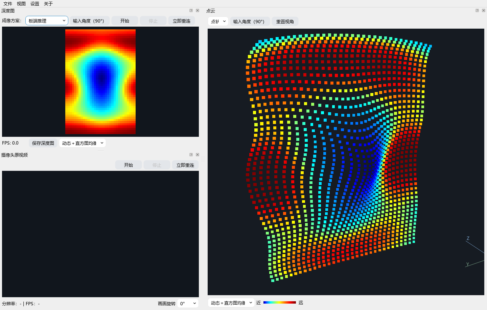
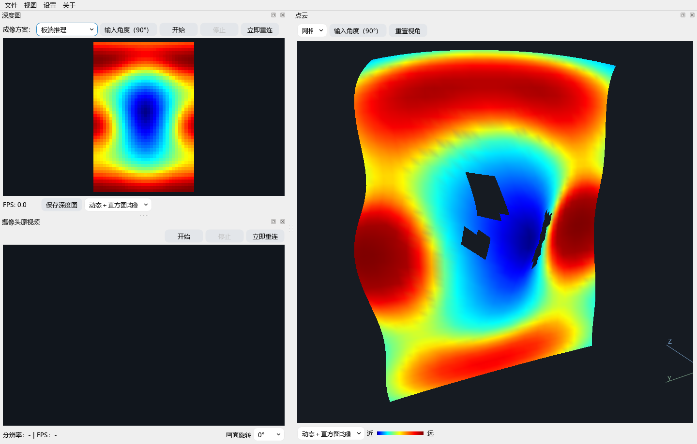

@page sdk_examples C 与 C++ 示例

C 和 C++ 链接同一份 CxwlDepthSdk.lib、加载同一个 DLL，无需分别构建 SDK。C 使用 DepthSdk.h；C++ 可直接使用该头文件，也可包含仅由头文件实现的 DepthSdk.hpp，获得错误异常、结构初始化和拥有数据的图像／深度帧副本。C++ 辅助层不改变会话所有者线程、帧有效期或关闭规则。

| 示例 | 运行参数 | 演示及输出 |
|---|---|---|
| CxwlDepthQuickStart | 可选模式 `board` 或 `high`，可选参数 `--reconnect` | 日志、诊断、等待两条流、主动重连、BUSY 关闭 |
| CxwlDepthQuality | 无 | 查询能力；逐行复制同帧深度／SNR／有效位，检查尺寸和跨度 |
| CxwlDepthPointCloud | `[-Out dir]` | 保存板端 XYZ 点云和同帧径向深度图，需要相机 |
| CxwlDepthDeviceManagement | list / scan / connect-usb / connect-saved ID / select ID / remove ID / repair ID / maintain ID / recover ID | 列出登记设备，核验 USB 并登记，按 ID 采集指定相机，或执行维护与恢复。两路就绪后打印设备 ID 并释放会话。 |
| CxwlDepthCppQuickStart | 无 | C++ Session、错误处理、回调中复制、回调外读取副本 |
| CxwlDepthThreadedCapture | 无 | 工作线程创建、轮询、关闭；消费线程只读副本；最新帧覆盖队列 |
| CxwlDepthSelfTest | `[-v] [-Report file.json]` | 离线检查公开导出、版本、六档能力和点云接口，并可输出诊断 JSON |
| CxwlDepthViewer | 无 | Qt Widgets 完整参考程序，SDK 调用集中在 demo/DepthSdkClient.cpp |

## 推荐运行顺序

```powershell
powershell -File Script/verify-sdk.ps1 -Strict
$out = Join-Path ([IO.Path]::GetTempPath()) ('cxwl-sdk-' + [guid]::NewGuid().ToString('N'))
New-Item -ItemType Directory -Path $out | Out-Null
./Example/bin/CxwlDepthSelfTest.exe -v -Report (Join-Path $out 'self-test.json')
# 接好已登记的相机后执行
./Example/bin/CxwlDepthPointCloud.exe -Out $out
./Example/bin/CxwlDepthQuickStart.exe board
./Example/bin/CxwlDepthQuickStart.exe high --reconnect
# 接好已登记的相机后执行
./Example/bin/CxwlDepthPointCloud.exe -Out $out
./Example/bin/CxwlDepthDeviceManagement.exe scan
./Example/bin/CxwlDepthDeviceManagement.exe connect-usb
```

PointCloud 在 `-Out` 指定的已有目录创建 cloud.ply 与 depth.pgm。省略参数时使用当前目录。PGM 保存大端 16 位毫米值，0 表示无效。该命令行示例的 cloud.ply 以 ASCII 文本写入有效 XYZ，单位米。Viewer 和 `CxwlDepth_SavePointCloudPly` 导出小端二进制 PLY。文件写入失败返回非零。

## USB 路径选择

| 生命周期 | 检查 | 登记／开始 | 用途 |
|---|---|---|---|
| 推荐：管理器 + ConnectWithOptions | ScanUsb，GetManagerStatus.usb_check_id | target=USB，传入同一管理器的检查 ID | 有设备选择、维护或管理界面的应用 |
| Open 的分步会话 | CheckUsb，GetUsbStatusAlloc 返回 check_id | EnrollUsb(check_id, start_after)，随后可 Start | 自行控制配置和启动时机 |
| 默认自动接入 | Connect 内部执行 | SDK 按默认策略处理 | QuickStart 与简单集成 |

两台相机可同时接入 Windows。登记时在当前进程设置 `CXWL_DEPTH_USB_SERIAL` 为目标机身序号，运行 `scan` 核对目标，再运行 `connect-usb`。每次 `connect-usb` 都会自行扫描并在同一管理器内使用新的检查 ID。登记后运行 `list`，将返回的 `id` 传给 `connect-saved ID`。两个进程各指定一个不同的设备 ID，即可同时采集。

这些是仍受支持的互补入口，不能仅因功能相近而标为弃用。Subscribe 适合只收图像；SubscribeEx 适合同时读取质量图，两者互相替换。

共享 C 辅助函数在 Example/common/SampleSupport.h。示例提示使用 UTF-8 中英双语；API 标识、JSON 字段和底层诊断原文保持不变，便于检索。异步失败使用 error_category，不能把旧的 GetLastError 当成此次异步操作的结果。跨线程示例不让 SDK 句柄离开工作线程。


## 任务 → API 与示例

| 我要完成的任务 | API／字段 | 参考示例 |
|---|---|---|
| 无相机验证运行库 | `CxwlDepth_AbiVersion`、`CxwlDepth_GetCapabilities` | SelfTest |
| 快速连接并接收两条流 | `CxwlDepth_Connect`、`CxwlDepth_WaitForEvent`、`frame.stream` | C QuickStart |
| 连接指定已登记设备 | `CxwlDepth_ConnectWithOptions`、`CXWL_DEPTH_TARGET_SAVED`、`CXWL_DEPTH_CONNECT_SAVED_ONLY` | DeviceManagement connect-saved ID |
| 检查 USB 后登记 | `CxwlDepth_ScanUsb`、`CxwlDepthManagerStatus.usb_check_id` | DeviceManagement connect-usb |
| 判断断流／恢复进度 | `CxwlDepthSessionStatus.state`、帧可用位、`CxwlDepth_GetStateAlloc` | QuickStart、QtViewer |
| 读取同帧质量图 | `CxwlDepth_SubscribeEx`、`snr`、`valid_mask` | DepthQuality |
| 保存米制点云与深度图 | `CxwlDepth_GetFramePointCloud` | PointCloud 采集后导出 PLY 和 PGM |
| 读取板端 XYZ、导出一帧或录制连续点云 | `CxwlDepth_GetFramePointCloud`、`CxwlDepth_SavePointCloudPly` | QtViewer 点云面板 |
| 工作线程采集 | `CxwlDepth_WaitForEvent`、回调内复制、同线程关闭 | ThreadedCapture |
| 重连或切换采集模式 | `CxwlDepth_Reconnect`、`CxwlDepth_SetMode` | QuickStart `--reconnect`、QtViewer |
| 停采并彻底释放 | `CxwlDepth_Disconnect` 或 `CxwlDepth_Close` 返回 BUSY 时派发并重试 | SampleSupport.h |
| 修复载荷／故障恢复 | `CxwlDepth_MaintainBoardFiles`、`CxwlDepth_RecoverDevice` | DeviceManagement repair／recover |
| 保存诊断 JSON | `CxwlDepth_GetStateAlloc`、`CxwlDepth_FreeJson` | C++ 辅助头；DeviceManagement |

## Viewer 窗口

深度图的「成像方案」提供「48×32 普通」和「48×32 高精度」。在自己的应用中，可调用 `CxwlDepth_Connect` 或 `CxwlDepth_SetMode` 选择 8×8、16×16 和 48×32 的任一精度档。

采集出帧后，在右侧点云工具栏点击「录制点云」并选择保存目录。录制前可独立勾选「同时录制深度」与「同时录制 RGB」，默认只保存点云。深度写入同编号的 `depth/frame-*.f32`，RGB 按相机帧率单独编号并写入 `rgb/frame-*.jpg`。勾选 RGB 后，`frames.csv` 记录各帧的来源时间和上位机接收时间。点击「停止录制并保存」，界面会显示已写入的帧数和目录。每帧保存为一个按接收顺序编号的 PLY 文件。录制中可以切档，文件头保留每帧的实际网格、档位和时间戳。停止采集或关闭窗口也会保存已录帧。写盘中断时，已完整写出的文件保存在带 `.partial` 后缀的目录中。

左上为径向深度，左下为独立 RGB 视频，右侧为 ToF 坐标系点云。点云左键旋转、中键平移、滚轮缩放；“重置”恢复视角。点状／网格和固定／动态／直方图色标可以独立设置。点云输入角度与视频显示旋转分开保存，改变显示角度不会重新标定设备。

状态栏的「复制诊断」会将 SDK 版本、ABI、设备 ID、连接状态及最近一次采集错误复制为 JSON。

下图由相同 Viewer 控件离线渲染，深度为合成演示，视频区无相机输入；用于说明窗口操作，不是实机拍摄或精度证据。




